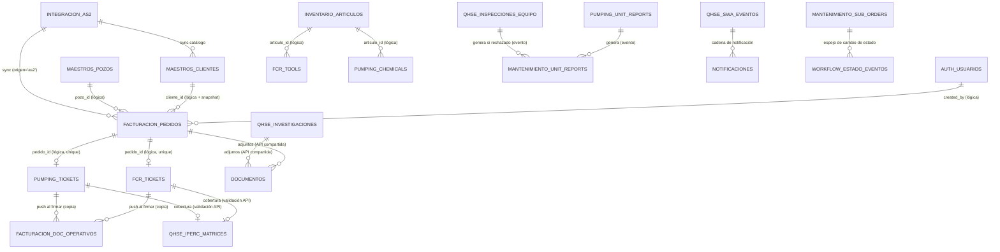
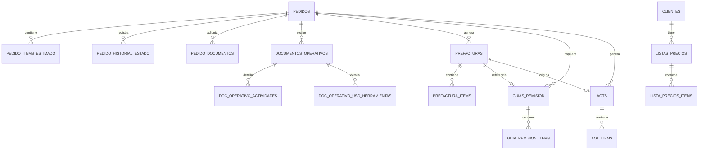
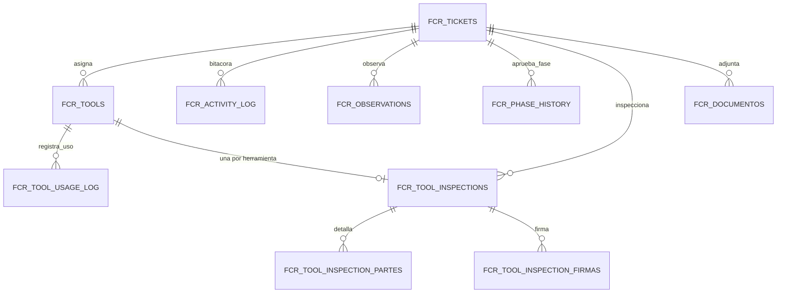
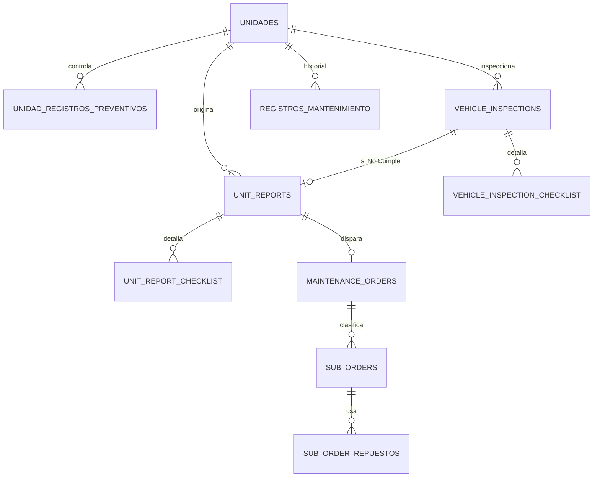
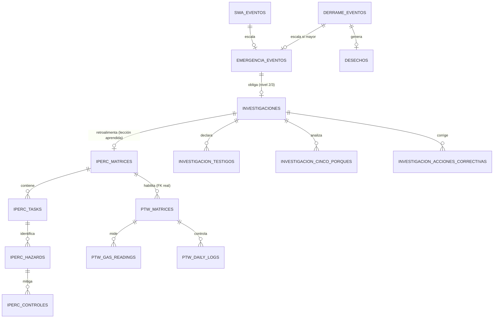

# Análisis integral y propuesta de arquitectura de base de datos — Dynadrill

> **Etapa 1 — Análisis y propuesta.** Este documento NO implica ningún cambio de código, migración ni modelo. Es la base de discusión para decidir la arquitectura de datos definitiva antes de pasar a la Etapa 2 (implementación). Fuentes: `dynadrill-backend/prisma/schema.prisma` (schema real del "backend tonto"), `documentacion/backend/ANALISIS-BACKEND-TONTO.md`, `dynadrill/dynadrill-frontend/src/app/**/*.model.ts` y mock interceptors (recuperados de `git show 86428ac^`, commit previo al retiro de mocks), `documentacion/{facturacion,fcr,integracion-as2,mantenimiento,pumping,qhse,uml}`, `DYNADRILL-Phase1/`, `vault-dynadrill/` (base de conocimiento Obsidian ya curada).

> ### ✅ Decisiones ya confirmadas por el negocio (revisión conjunta, 2026-09-18)
> 1. **ORM/motor:** se confirma **Prisma + PostgreSQL** como stack del proyecto real — el pedido original de "Sequelize" fue un error de tipeo del usuario, no una decisión de migrar de ORM. **SQLite queda descartado como motor de producción**: fue una elección deliberada solo para la etapa de "backend tonto" (compilado autocontenido, ver `ANALISIS-BACKEND-TONTO.md` §2/§7.2), pero el proyecto real se construye directamente sobre PostgreSQL — no hay una fase intermedia en SQLite que migrar "cuando se necesite": Etapa 2 parte de Postgres desde el primer schema. Queda descartada toda la sección 14.2 (plan Sequelize); Etapa 2 se planifica 100% sobre Prisma + PostgreSQL.
> 2. **Estrategia de IDs:** se confirma **UUID** como PK en vez de `BIGINT` + `code` (recomendación original de este documento, ver §9). Queda pendiente de Etapa 2 decidir la variante exacta (UUIDv4 vs. UUIDv7 — se recomienda **UUIDv7** por ser ordenable temporalmente, mejor para índices B-tree y paginación; ver nota actualizada en §9). Esto **sí implica** migrar `id: number` → `id: string` en los ~35 modelos del frontend — impacto aceptado explícitamente.
> 3. **Arquitectura de schemas (Alternativa C, un schema por dominio, sin FK física entre schemas):** confirmada tal como se propuso en §3-§4.
>
> El resto del documento (secciones 6, 13, etc.) todavía muestra `BIGINT`/`Int` en los borradores de tabla como quedaron redactados durante el análisis — con UUID confirmado, léase cada PK/FK como `UUID` en vez de `BIGINT`/`Int`; el detalle campo a campo se corrige de una vez en el DDL definitivo de Etapa 2, no tiene sentido reescribir aquí las ~71 tablas dos veces.
>
> ### ✅ Resolución de la sección 17 (revisión conjunta, 2026-09-18 — segunda ronda)
> 4. **Catálogo de roles:** confirmado por análisis de código — `Supervisor Operaciones FCR` (antes `roleId 15`) y `Operador FCR` (antes `roleId 18`) **son roles reales y activos**, usados en rutas/guards/sidebar de todo el módulo FCR, no una inconsistencia — solo faltaban en el catálogo de 14 roles *de prueba* del mock. Ver detalle en §17.
> 5. **Intervalos de mantenimiento preventivo:** se confirma el **documento oficial 2026** (`Plan-de-Mantenimiento-2026.md`) como fuente de verdad — solo tipos **A** (250h ±30h) y **B** (2000h ±50h); auxiliares cada 5000km o 180 días. Se descarta la escala de 4 tipos (250/500/1000/2000h) del BPMN `MAN-002` como obsoleta.
> 6. **Bandas de volumen de derrame:** se confirma lo **ya implementado en frontend** (`<1` / `1-10` / `>10` barriles) como vigente, sobre el proceso oficial documentado (`<1`/`1-5`/`>5`).
> 7. **5ª línea de servicio:** **no existe tal propuesta** — se confirma que las 4 líneas (Fishing/Pumping/Completion/CTU) son el catálogo cerrado y definitivo. La "duda" reportada en el análisis inicial fue una confusión propia del agente de exploración entre "línea de servicio" (4 valores fijos, RN-03 de FACT-001) y "tipo de servicio dentro de Pumping" (`PumpingServiceType`, 5 sub-valores: coiled_tubing/fluidos_control/cementación_remedial/estimulaciones/servicios_nitrógeno) — son dos catálogos distintos, no hay ambigüedad real.
> 8. **Alcance del Pedido:** confirmado — el ciclo local se detiene definitivamente en `aot_generada`; `enviado_a_control_de_costos`/`listo_para_facturar`/`facturado` **no se modelan como estados locales** (viven en AS2, fuera del dominio del Portal).
> 9. **`Unit` (modelo vestigial):** confirmado sin consumidores reales — se verificó por búsqueda en todo el frontend (`git grep`) que solo se exporta desde `shared/index.ts` y nunca se importa en ningún componente/servicio. Se retira del diseño (ya no estaba incluido como tabla) y se recomienda eliminarlo del frontend en Etapa 2 como limpieza de código muerto.
> 12. **Conductores (internos y externos):** se confirma un nuevo requerimiento — hoy no existen en base de datos, solo como lista no persistida. Se agrega la tabla `mantenimiento.conductores` (ver §6.6 actualizado).
> 13. **Prefacturas por Pedido:** confirmado histórico de varias prefacturas por pedido (cancelación + reemisión) — `prefacturas.pedido_id` **no lleva `UNIQUE`**, tal como ya recomendaba este documento.
> 15. **Almacenamiento de documentos:** confirmado — habrá un **directorio específico dedicado en el servidor** (no S3/object storage) para los adjuntos. Se mantiene el patrón `ruta_relativa` ya usado hoy, formalizado como decisión definitiva.
> 16. **Servicios transversales:** confirmado un cambio de alcance importante — se agregan **tres microservicios transversales desde el diseño** (no diferidos como se recomendaba originalmente): gestión documental, notificaciones y actualización/orquestación de estados. Ver nueva sección 6.9 y §4/§7 actualizados.
>
> Los puntos 3, 10 y 11 requerían aclaración antes de poder resolverse — la aclaración y la propuesta para el punto 14 se desarrollan en el cuerpo del documento (§6.1, §6.6, §17) y se resumen en el mensaje de respuesta de esta ronda.
>
> ### ✅ Cierre de la sección 17 (revisión conjunta, 2026-09-18 — tercera ronda) — **Etapa 1 aprobada, pasa a Etapa 2**
> 10. **Clave natural AS2:** confirmado — se usa el **mismo ID/número de pedido de AS2** como clave de reconciliación, sin generar uno propio en el Portal. `facturacion.pedidos.code` es literalmente ese número (ver §6.3 actualizado); la PK técnica sigue siendo el `UUID` interno.
> 11. **Auditoría campo-a-campo:** confirmado que **no es necesaria** — se mantiene solo el historial de estado por dominio (§10.2/§10.3), sin `audit_log` genérico.
> 14. **Propuesta de KPIs QHSE (§16.1):** aprobada para tomarse en cuenta en Etapa 2.
>
> Con esto, las 16 decisiones de §17 quedan cerradas.
>
> ### ✅ Revisión crítica adicional del schema propuesto (2026-09-18 — cuarta ronda)
> Tras revisar `schema-propuesto.prisma`, se identificaron patrones que reproducían literalmente limitaciones del código/BD actual en vez de resolverlas — el pedido explícito fue "que el diseño sea correcto, robusto y eficiente, aunque cambien los modelos actuales". Correcciones aplicadas (detalle en §6.1/§6.2/§6.6/§6.7/§6.8):
> - **`auth` — RBAC real:** `usuarios.rol_id` (un solo rol, autorización resuelta comparando nombres de rol en el frontend) se reemplaza por 4 tablas desacopladas: `roles`, `permisos` (catálogo granular), `rol_permisos` y `usuario_roles` (ambas M:N — un usuario puede tener más de un rol).
> - **`maestros` — se deja de duplicar personal Dynadrill:** `personas_contacto` mezclaba staff interno (agente comercial, analista) con contactos externos del cliente. El staff ahora referencia `auth.usuarios` directo; `contactos_cliente` queda solo para representantes del cliente.
> - **`maestros.personas` (nuevo):** generaliza el patrón interno/externo que antes se resolvía solo para conductores — reusado por Mantenimiento (conductores) y QHSE (heridos, testigos, EPI).
> - **`integracion_as2` — catálogos que AS2 realmente posee:** condición de pago, forma de pago, canal, zona y bodega dejan de ser texto libre en `Pedido` — se modelan como espejos sincronizados, mismo criterio ya aplicado a `clientes`.
> - **`mantenimiento.unidades` se separa en 3 tablas** (identidad / patrimonio / control operativo) por tener dueños y cadencias de escritura distintos; se corrige `maintenance_orders.unidad_id` a FK física real (había quedado lógica sin motivo, mismo schema).
> - **`inventario.categorias_articulo` (nuevo):** `Articulo.categoria` deja de ser texto libre — 'HERRAMIENTAS' dispara lógica de negocio real y no debía depender de que nadie tipeara mal el string.
> - **`qhse`:** `rol_notificado` (texto libre) pasa a `rol_notificado_id` (ref. a `auth.roles`) en `swa_notificaciones`/`emergencia_notificaciones`; se agrega `investigacion_trabajador_involucrado` (vacío detectado, no existía en la primera versión); `emergencia_heridos`/`entregas_epi` referencian `maestros.personas`.
>
> El resto de este documento (Etapa 2 en adelante) se ejecuta en el propio código de `dynadrill-backend`, no en este archivo — este análisis queda como referencia de diseño, actualizada con cada ronda de revisión.

---

## 1. Resumen ejecutivo

Dynadrill tiene hoy **dos capas de verdad que no coinciden**:

1. **El backend real conectado al frontend** (`dynadrill-backend`, NestJS + **Prisma** + SQLite — no Sequelize, ver nota crítica abajo) modela correctamente las *raíces de agregado* de cada dominio (Pedido, FcrTicket, PumpingTicket, Unidad, MaintenanceOrder, los 10 sub-módulos QHSE, etc.) y sus relaciones entre raíces, pero deja casi todo el contenido de negocio real **aplanado en una columna `payload` de texto JSON** por diseño explícito ("backend tonto" — ver `ANALISIS-BACKEND-TONTO.md` §5). Esto fue una decisión correcta para su objetivo (reemplazar arrays en memoria del mock por persistencia real, rápido), pero **no es el diseño de producción**.
2. **El frontend Angular** (`*.model.ts`) sí tiene el dominio real, exhaustivamente tipado: estados, sub-estructuras, catálogos, reglas de negocio en comentarios. Es la fuente más confiable de "qué campos existen realmente", más rica que el backend actual.

A esto se suma una tercera capa — el **vault de conocimiento Obsidian** (`vault-dynadrill/`) y la documentación de negocio (`documentacion/`, `DYNADRILL-Phase1/`) — que aporta lo que ni el frontend ni el backend pueden dar: **reglas de negocio numeradas (RN-xxx), plazos legales, fórmulas de clasificación de riesgo, y el hecho de que el ERP externo AS2 es dueño de varios catálogos maestros** (clientes, contratos, lista de precios, numeración de pedidos/facturas).

**Propuesta en una frase:** una única base de datos PostgreSQL con **un schema por dominio de negocio** (futuro microservicio), **sin foreign keys físicas entre schemas**, **con historial de estado como tabla propia por dominio** (no centralizado), **IDs `BIGINT` internos + `UUID` público opcional para integraciones**, y una **migración gradual de `payload` JSON a columnas/tablas reales** guiada por qué sub-estructuras necesitan hoy consulta/reportería SQL (la mayoría, según el análisis del frontend) frente a las que genuinamente son bitácoras de solo lectura completa.

### ✅ Discrepancia de ORM — resuelta

El prompt original de este análisis mencionaba **"NestJS + Sequelize"**; se confirmó que fue un error de tipeo — el stack real y definitivo es **NestJS + Prisma** (`dynadrill-backend/package.json`: `"@prisma/client"`, sin ninguna dependencia de Sequelize en el repo). Todo este documento diseña el **modelo relacional** (independiente de ORM), y el plan de migraciones/seeders de la sección 14 asume Prisma como definitivo.

---

## 2. Hallazgos del código y la documentación actual

### 2.1 Lo que existe y funciona hoy
- Backend NestJS + Prisma + SQLite, monorepo (`apps/api-gateway` + `libs/`), **ya con las 8 fases de su plan completas**: los 8 dominios tienen CRUD real y el frontend ya no usa mocks (se retiraron en el commit `86428ac`, 2026-09-04).
- El schema de Prisma ya fija correctamente casi todas las relaciones *entre raíces de agregado* (Pedido↔FcrTicket/PumpingTicket 1:1 vía `pedidoId @unique`, MaintenanceOrder→SubOrder, Unidad→UnitReport, etc.). **Esta topología de relaciones es reutilizable casi tal cual** para el diseño de producción — el trabajo real es "desempacar" los `payload`.
- Reglas de negocio duras ya implementadas y verificadas en el backend actual (no solo el frontend): stock no puede quedar negativo, un Pedido no puede tener dos tickets operativos, un PTW no puede abrirse sin IPERC aprobado (HTTP 400), etc. Estas reglas deben preservarse como constraints/triggers o lógica de servicio en el diseño definitivo.

### 2.2 Lo que está simulado o es deliberadamente provisional
- **Todo el `payload` JSON** de cada tabla — es el mock aplanado, no un diseño relacional.
- **La integración AS2 es 100% simulada** (`origen`, `as2Ref`, `lastSyncedAt`, cola `PedidoPendienteAs2`) — el ERP real no tiene API expuesta hoy; hay un documento borrador pidiéndosela al proveedor (Asinfo).
- **Adjuntos/documentos**: hay tablas reales de metadata (`PedidoDocumento`, `FcrDocumento`, `PumpingDocumento`) con subida a disco local — funcional pero sin estrategia de storage de producción (S3-compatible) ni versión.
- **`clienteId` y las FKs de ubicación (`campoId/bloqueId/pozoId/taladroId`) son nullable "en paralelo" a sus columnas de texto** — es deuda de migración reconocida en el propio código (comentario explícito: causó un bug de "prefactura en $0" por no matchear cliente).
- Auth es funcionalmente real (JWT + bcrypt) pero sin autorización fina por fase de workflow a nivel de backend — la comparación de "qué rol puede actuar en qué fase" vive **hardcodeada por nombre de string** en el frontend (`FCR_PHASE_ROLE`, `PUMPING_STEP_ROLE`), no en una tabla.

### 2.3 Lo que se está proponiendo (no existe en ningún lado todavía)
- Normalización de las sub-estructuras anidadas (historiales de estado, checklists, logs, firmas, matrices IPERC/PTW, ítems de listas de precios/prefacturas) a tablas hijas reales.
- Separación en schemas por dominio con criterio de propiedad de datos explícito.
- Estrategia de IDs unificada pensada para microservicios.
- Un modelo de "documento/adjunto" y de "historial de estado" **reutilizable como patrón**, pero implementado **una vez por schema/servicio** (no como microservicio compartido desde el día uno — ver §7).
- Catálogo de roles con `code` estable + tabla de "responsable por fase/paso de workflow" (reemplaza las comparaciones de string hardcodeadas).

### 2.4 Inconsistencias detectadas (a resolver antes de congelar el esquema)

| # | Inconsistencia | Fuente | Impacto en el diseño |
|---|---|---|---|
| 1 | `clienteId` opcional en `Pedido` y `ListaPrecios`, matching real por texto libre → bug de prefactura en $0 ya reportado | schema.prisma + `facturacion-domain.service.ts` | `cliente_id` debe ser `NOT NULL FK` en el diseño definitivo; requiere backfill de datos existentes |
| 2 | Campos de ubicación duplicados string + FK opcional en paralelo (`Pedido`, `Ticket`, `PumpingTicket`) | `*.model.ts` | Definir el catálogo `pozo/campo/bloque/taladro` como única fuente; los strings pasan a ser *derivados* (vista/join), no columnas propias |
| 3 | Roles referenciados en lógica de fase (`roleId 15/18`) que no existen en el catálogo de roles sembrado (14 roles) | `fcr.model.ts` vs `users-mock` | **✅ Resuelto:** `Supervisor Operaciones FCR` y `Operador FCR` son roles reales y activos (usados en rutas/guards/sidebar de FCR y Mantenimiento) — solo faltaban en el seed de prueba. El catálogo real de roles de Etapa 2 debe incluir, como mínimo, estos 2 más los 14 ya sembrados = 16 roles confirmados; se recomienda una pasada explícita por todo `allowedRoles`/`roleName` del frontend para confirmar que no falta ninguno más antes de fijar el seed definitivo |
| 4 | Comparación de "rol responsable" por **nombre de texto**, no por `id`/`code` estable | `FCR_PHASE_ROLE`, `PUMPING_STEP_ROLE`, `esRolResponsablePumping()` | La tabla `roles` necesita un `code` inmutable; la lógica de responsable-por-fase debe vivir en una tabla de configuración, no en código |
| 5 | Posible modelo de "Unidad" duplicado: `Unidad` (mantenimiento, rico) vs `Unit` (`shared/models/unit.model.ts`, parece vestigial) | frontend | **✅ Resuelto:** verificado por búsqueda completa en el frontend — `Unit` no tiene ningún consumidor real (solo se exporta, nunca se importa). Se retira del diseño; se recomienda eliminarlo del código en Etapa 2 |
| 6 | `itemEstimado` (singular, deprecated) convive con `itemsEstimados` (array) en `Pedido` | `pedido.model.ts` | El diseño definitivo asume siempre array (`PedidoItemEstimado` como tabla); requiere decidir qué pasa con pedidos históricos con el shape viejo |
| 7 | Intervalos de mantenimiento preventivo: BPMN dice 250/500/1000/2000h con 4 tipos; documento oficial 2026 dice solo A (250h) y B (2000h) | `MAN-002` vs `Plan-de-Mantenimiento-2026.md` | **✅ Resuelto:** rige el documento oficial 2026 — solo tipos A (250h±30h) y B (2000h±50h); auxiliares 5000km/180 días |
| 8 | Bandas de volumen de derrame: proceso oficial documentado (<1/1-5/>5 barriles) vs. lo ya implementado en frontend (<1/1-10/>10) | `HSE-AMBIENTAL-002` vs código | **✅ Resuelto:** rige lo implementado en frontend (<1/1-10/>10 barriles) |
| 9 | Existencia de una posible 5ª línea de servicio (hoy: Fishing/Pumping/Completion/CTU) | documentación de facturación | **✅ Resuelto — no existe tal ambigüedad real.** Era una confusión del análisis inicial entre "línea de servicio" (4, fija) y "tipo de servicio de Pumping" (`PumpingServiceType`, 5 sub-valores distintos, un catálogo distinto). Se confirman 4 líneas cerradas |
| 10 | Estados finales de Pedido fuera del alcance actual del app (`enviado_a_control_de_costos`, `listo_para_facturar`, `facturado`) — el ciclo completo vive parcialmente en AS2/SRI | `pedido.model.ts` + documentación | **✅ Resuelto:** el Portal se detiene definitivamente en `aot_generada`; esos 3 estados no se modelan localmente |
| 11 | Mocks eliminados del working tree (`86428ac`) — el frontend ya habla con `dynadrill-backend` real vía proxy | git history | El diseño debe partir del backend real (`schema.prisma`), no de los mocks, para el "estado actual"; los mocks solo sirven para reconstruir el *dominio* histórico |

---

## 3. Arquitectura de base de datos propuesta

### 3.1 Alternativas evaluadas

| Criterio | A — Una BD, un schema | B — Una BD por microservicio | C — Híbrida (recomendada) |
|---|---|---|---|
| Independencia de despliegue | Nula | Total desde el día uno | Total a nivel lógico; física cuando se necesite |
| Complejidad operativa (equipo actual, ~1 backend) | Mínima | Alta (N instancias, N credenciales, N backups) desde ya, sin equipo para sostenerlo | Mínima hoy, crece solo cuando se justifica |
| Integridad referencial entre dominios | Fácil (FK física), pero **acopla los servicios a nivel de BD** — el peor enemigo de "microservicio independiente" | Ninguna FK física — fuerza a resolver bien el ownership de datos desde ya | Ninguna FK física entre schemas (mismo beneficio que B), pero sin el costo operativo de B |
| Transacciones distribuidas | Triviales (transacción SQL normal) — pero es una trampa: el día que se separen los schemas en servicios reales, esas transacciones dejan de existir y el código que dependía de ellas se rompe en producción | Hay que resolverlas desde ya (sagas/eventos) | Se diseñan **como si** no hubiera transacción distribuida (mismo criterio que B) aunque hoy técnicamente sí se podría — evita la trampa de A |
| Reportería / BI | Muy simple (todo en un lugar) | Requiere agregación entre bases | Simple ahora (mismo motor); requiere ETL/vistas cuando se separen físicamente |
| Evolución a microservicios reales | Requiere reescritura del acceso a datos | Ya está lista | Solo requiere mover el schema a otra instancia — cero cambio de modelo |
| Seguridad / control de acceso | Un solo usuario de BD para todo (riesgo) | Aislamiento fuerte por credenciales | Un rol de BD por schema desde el día uno (mismo aislamiento lógico que B) |

### 3.2 Recomendación: **Alternativa C — un único clúster PostgreSQL, un schema por dominio/futuro microservicio, sin FKs físicas entre schemas**

Razones específicas a Dynadrill (no genéricas):

1. **El equipo y el volumen actuales no justifican N bases de datos separadas.** El propio `ANALISIS-BACKEND-TONTO.md` documenta que hoy hay un backend, un desarrollador, y el objetivo fue explícitamente "no levantar infraestructura". Forzar 8 instancias de Postgres hoy sería sobre-ingeniería pura — exactamente lo que el prompt de este análisis pide evitar.
2. **Los bounded contexts ya están naturalmente delineados** por la propia documentación de negocio (el vault trata Facturación/Pumping/FCR/Mantenimiento/QHSE como áreas independientes con "puntos de integración" explícitos) — el trabajo de separar dominios YA está hecho a nivel de negocio; solo falta reflejarlo en schemas.
3. **La disciplina de "cero FK física entre schemas"** es la que realmente importa para poder migrar a microservicios después — no la cantidad de instancias de Postgres. Si hoy se permite una FK `facturacion.prefacturas.pedido_id → facturacion.pedidos.id` (mismo schema, está bien) pero se prohíbe `operaciones_fcr.fcr_tickets.pedido_id → facturacion.pedidos.id` como FK física (cross-schema), el día que `facturacion` se mueva a su propia instancia, `operaciones_fcr` no se entera — porque nunca dependió de eso a nivel de motor.
4. **Postgres soporta bien el camino de salida**: `pg_dump --schema=X` + `pg_restore` a una instancia nueva es una migración de bajo riesgo cuando (y solo cuando) el volumen/tráfico de un dominio lo justifique. No hay que decidirlo todo hoy.

### 3.3 Regla de integridad entre dominios (crítica, aplica desde ya)

- **Dentro de un schema (mismo microservicio futuro): FK física real**, con `ON DELETE`/`ON UPDATE` explícitos, índices, constraints — todo lo relacional clásico.
- **Entre schemas (distintos microservicios futuros): jamás FK física.** Se referencia por **ID lógico** (`pedido_id BIGINT`, sin constraint), documentado en un comentario de columna y validado a nivel de aplicación (el servicio que escribe valida contra el servicio dueño vía llamada — hoy función/import, mañana API).
- Cuando un dominio necesita **mostrar** datos de otro (ej. Facturación necesita nombre de cliente al listar pedidos), la opción es:
  - **(a) Referencia por ID + consulta on-demand** (hoy: join directo entre schemas, técnicamente posible pero *prohibido por convención* para no crear dependencia oculta; mañana: llamada API/gRPC), o
  - **(b) Snapshot/copia de los campos que se necesitan mostrar**, tomados en el momento de la transacción (ej. `Pedido.cliente_nombre_snapshot` al crearlo) — es la solución correcta cuando el dato mostrado debe ser **inmutable en el tiempo** (una prefactura no debe cambiar su nombre de cliente si el cliente se renombra después).
- Este documento indica, tabla por tabla en la sección 7, cuál de las dos aplica.

---

## 4. Módulos y schemas propuestos

| Microservicio (futuro) | Schema | Responsabilidad | Justificación |
|---|---|---|---|
| `auth-service` | `auth` | Usuarios, roles, permisos, sesión/autenticación, mapa rol↔responsable-de-fase | Seguridad transversal; consumido por todos, pero dueño único de identidad |
| `maestros-service` (nuevo, no identificado por el usuario pero necesario) | `maestros` | Catálogo de ubicación operativa (bloque/campo/pozo/taladro), clientes, personas de contacto | Datos de referencia compartidos por Facturación, FCR, Pumping, Mantenimiento y QHSE por igual — duplicarlos en cada dominio viola la regla "no dupliques sin razón arquitectónica" |
| `facturacion-service` | `facturacion` | Pedido (entidad ancla del negocio), listas de precios, documentos operativos recibidos, prefactura, guía de remisión, AOT | Dominio con más reglas de negocio maduras y documentadas; es el "cliente" de casi todos los demás dominios |
| `integracion-as2-service` | `integracion_as2` | Espejo de catálogos externos (clientes/contratos/lista de precios/secuencias de AS2), cola de sincronización, log de sync | AS2 es *fuente de verdad externa* — no se modela junto a Facturación para no mezclar "dato propio" con "caché de sistema externo"; separarlo permite cambiar la estrategia de integración sin tocar el dominio de negocio |
| `fcr-service` | `operaciones_fcr` | Tickets FCR, fases, herramientas asignadas, checklist de inspección/reparación, documentos FCR | Subdominio con lógica propia fuerte (control de inventario de herramientas del cliente, cadena de firmas) |
| `pumping-service` | `operaciones_pumping` | Tickets Pumping, químicos, herramientas, reporte de unidad, gerenciamiento de viaje, reporte diario, solicitudes de cambio de ítems | Paralelo a FCR pero con procesos propios (viaje, químicos) |
| `mantenimiento-service` | `mantenimiento` | Unidades (patrimonio + operación), órdenes/sub-órdenes, reportes de unidad, inspecciones vehiculares, historial, permisos de conductor | Dominio con máquina de estados propia y disparadores automáticos desde Pumping/FCR/QHSE |
| `inventario-service` | `inventario` | Artículos, BOM de herramientas, kardex de movimientos | Aunque pequeño, es consumido por FCR (herramientas), Pumping (químicos) y potencialmente Mantenimiento (repuestos) — bounded context propio de "stock", no debe vivir dentro de FCR ni Mantenimiento |
| `qhse-service` | `qhse` | 10 sub-dominios: IPERC, PTW, STOP, SWA, derrames, desechos, emergencias, EPI, inspecciones de equipo, investigaciones, metas de dashboard | El dominio más grande y regulado; sus sub-dominios están relacionados *entre sí* (IPERC→PTW, SWA/derrame→emergencia→investigación→IPERC) pero casi no dependen de otros servicios salvo por referencia a ticket/pedido |
| `documentos-service` **(confirmado, ver §6.9)** | `documentos` | Gestión centralizada de adjuntos de todos los dominios (metadata + ruta en el directorio dedicado del servidor) | Reemplaza el patrón repetido de `PedidoDocumento`/`FcrDocumento`/`PumpingDocumento` casi idénticos en cada schema — decisión confirmada de negocio de tenerlo como servicio propio desde el diseño, revirtiendo la recomendación original de este documento de diferirlo |
| `notificaciones-service` **(confirmado, ver §6.9)** | `notificaciones` | Envío y registro de notificaciones disparadas por eventos de negocio (cambios de estado, cadenas de notificación QHSE, alertas de vencimiento) | Reemplaza las cadenas de notificación hardcodeadas por rol (`swa_notificaciones`, `emergencia_notificaciones`) por un servicio reusable por todos los dominios |
| `workflow-service` **(confirmado, ver §6.9)** | `workflow` | Orquestación/consulta transversal de "actualización de estados": recibe eventos de cambio de estado de cada dominio y los centraliza para consulta cruzada y disparo de notificaciones | Cada dominio **sigue siendo dueño** de su propio estado actual y su propio historial (no se le quita esa responsabilidad) — este servicio es un consumidor/espejo de esos eventos, no la fuente de verdad |

**Sobre `core`/`catalogos` genéricos:** se descarta un schema `core` fantasma que termine siendo un cajón de sastre. En su lugar: `maestros` es un schema con propósito concreto y acotado (ubicación operativa + terceros comerciales), y los catálogos verdaderamente pequeños y de solo lectura interna de cada dominio (tipos de servicio, tipos de movimiento, motivos fijos) **viven como `CHECK`/enum dentro de su propio schema**, no en un catálogo central — ver criterio en §8.

**Sobre `auditoria` transversal:** se descarta un schema de auditoría centralizado por ahora. Cada schema mantiene su propia tabla de historial de estado (ya es un patrón nativo del dominio — `historialEstados`, `phaseHistory`, etc.) y sus columnas de auditoría estándar (§10). Centralizar auditoría solo tiene sentido cuando exista un requerimiento real de compliance/SIEM que lo pida explícitamente — no es el caso hoy (decisión pendiente de negocio si esto cambia).

---

## 5. Inventario completo de tablas propuestas

Leyenda tipo: **R** = raíz de agregado transaccional, **H** = tabla hija/detalle (vive con su raíz), **C** = catálogo/maestro, **X** = histórico/log append-only.

### Schema `auth`

| Tabla | Tipo | Descripción |
|---|---|---|
| `roles` | C | Catálogo de roles de negocio con `code` estable + `nombre` de UI — ya NO define directamente qué puede hacer un rol (✅ revisión RBAC, ver §6.1) |
| `permisos` | C | Catálogo granular de capacidades (`<modulo>.<recurso>.<accion>`), independiente de los roles |
| `rol_permisos` | H | Qué puede hacer cada rol — puente M:N `roles`↔`permisos` |
| `usuario_roles` | H | Qué rol(es) tiene cada persona — puente M:N `usuarios`↔`roles`, permite más de un rol por usuario |
| `usuarios` | R | Cuenta + perfil (login, estado de acceso) — ya sin `rol_id` propio |
| `usuarios_datos_rrhh` | H | Datos de RRHH (1:1 con `usuarios`) — separado porque su ciclo de vida y su dueño real (RRHH) difieren del de la cuenta de acceso |
| `workflow_rol_responsable` | C | Reemplaza `FCR_PHASE_ROLE`/`PUMPING_STEP_ROLE` hardcodeados: `(dominio, fase_o_paso, rol_id)` — sigue apuntando a `roles`, es sobre responsabilidad de workflow, no un permiso genérico |

### Schema `maestros`

| Tabla | Tipo | Descripción |
|---|---|---|
| `bloques` | C | Catálogo de bloques |
| `campos` | C | Catálogo de campos (con activo Petroecuador, zona comercial) |
| `taladros` | C | Catálogo de taladros/rigs |
| `pozos` | C | Catálogo de pozos, FK a bloque y campo |
| `clientes` | C | Catálogo real de clientes (RUC, nombre comercial/fiscal) — reemplaza texto libre |
| `clientes_contratos` | C | Contratos por cliente (número, vigencia) — hoy aplanado como texto en `Pedido.numeroContrato` |
| `contactos_cliente` | C | ✅ Reemplaza `personas_contacto`: SOLO representantes del propio cliente (campo/Quito), ligados a `cliente_id` — el personal Dynadrill (agente comercial, analista) ya no vive acá, referencia directa a `auth.usuarios` (ver §6.2) |
| `personas` | C | ✅ Nuevo: catálogo compartido de personas físicas no necesariamente usuarias del sistema (conductores, heridos, testigos, receptores de EPI) — generaliza el patrón interno/externo, reusado por `mantenimiento` y `qhse` (ver §6.2) |

### Schema `integracion_as2`

| Tabla | Tipo | Descripción |
|---|---|---|
| `as2_pedidos_pendientes` | X | Cola de pedidos creados en AS2 aún no sincronizados |
| `as2_sync_log` | X | Bitácora de sincronizaciones (éxito/error, payload recibido) |
| `as2_secuencias` | C | Espejo de la numeración que posee AS2 (pedido/prefactura/factura/guía) si se decide reservar localmente |
| `as2_condiciones_pago` | C | ✅ Nuevo: espejo del catálogo de condición de pago que posee AS2 — reemplaza texto libre en `Pedido.condicionPago` |
| `as2_formas_pago` | C | ✅ Nuevo: espejo del catálogo de forma de pago de AS2 |
| `as2_canales` | C | ✅ Nuevo: espejo del catálogo de canal comercial de AS2 |
| `as2_zonas` | C | ✅ Nuevo: espejo del catálogo de zona comercial de AS2 — reemplaza texto libre en `Pedido.zona` |
| `as2_bodegas` | C | ✅ Nuevo: espejo del catálogo de bodegas de AS2 — reemplaza texto libre en `Pedido.bodega` |

### Schema `facturacion`

| Tabla | Tipo | Descripción |
|---|---|---|
| `pedidos` | R | Entidad ancla del negocio |
| `pedido_items_estimado` | H | Ítems cotizados (reemplaza `itemsEstimados` JSON) |
| `pedido_historial_estado` | X | Historial de `EstadoPedido`, append-only |
| `listas_precios` | C | Tarifario por cliente/contrato |
| `lista_precios_items` | H | Ítems del tarifario |
| `documentos_operativos` | R | Reporte Job / Reporte de Herramientas recibidos desde FCR/Pumping |
| `documento_operativo_actividades` | H | Bitácora de actividades del documento |
| `documento_operativo_uso_herramientas` | H | Uso de herramientas por día (O/S/D/V) |
| `prefacturas` | R | "Ticket" de facturación |
| `prefactura_items` | H | Líneas de la prefactura |
| `guias_remision` | R | Guía de remisión interna |
| `guia_remision_items` | H | Ítems de la guía |
| `aots` | R | Orden de trabajo / resumen de costos final |
| `aot_items` | H | Detalle de la AOT |

> Nota: `pedido_documentos` (adjuntos del pedido) **no vive en este schema** — se centralizó en `documentos.documentos` (servicio transversal, §6.9/§17.16); Facturación solo referencia el `documento_id` que le corresponde.

### Schema `operaciones_fcr`

| Tabla | Tipo | Descripción |
|---|---|---|
| `fcr_tickets` | R | Ticket FCR con fase actual |
| `fcr_tools` | H | Herramientas asignadas al ticket |
| `fcr_tool_usage_log` | X | Uso diario por herramienta (O/S/D/V + metadatos técnicos) |
| `fcr_activity_log` | X | Bitácora de actividades |
| `fcr_observations` | X | Observaciones libres |
| `fcr_phase_history` | X | Aprobaciones de fase (append-only, inmutable una vez firmada) |
| `fcr_tool_inspections` | R | Checklist de inspección/reparación por herramienta |
| `fcr_tool_inspection_partes` | H | Snapshot de partes evaluadas |
| `fcr_tool_inspection_firmas` | H | Firmas de la cadena reparado→revisado→liberado QHSE |

> Nota: `fcr_documentos` no vive en este schema — centralizado en `documentos.documentos` (§6.9).

### Schema `operaciones_pumping`

| Tabla | Tipo | Descripción |
|---|---|---|
| `pumping_tickets` | R | Ticket Pumping con paso actual |
| `pumping_chemicals` | H | Químicos asignados/usados/devueltos |
| `pumping_tools` | H | Herramientas asignadas |
| `pumping_operators` | H | Operadores asignados al ticket |
| `pumping_unit_reports` | R | Reporte de unidad (puente a Mantenimiento) |
| `pumping_unit_report_checklist` | H | Ítems de checklist salida/llegada |
| `travel_managements` | R | Gerenciamiento de viaje (ida/regreso) |
| `travel_risk_answers` | H | Respuestas a las 12 preguntas de riesgo |
| `daily_activity_reports` | R | Reporte diario de actividades |
| `daily_activity_entries` | H | Líneas de actividad del día |
| `solicitudes_cambio_items` | R | Solicitud bidireccional Pumping↔Facturación |

> Nota: `pumping_documentos` no vive en este schema — centralizado en `documentos.documentos` (§6.9).

### Schema `mantenimiento`

| Tabla | Tipo | Descripción |
|---|---|---|
| `unidades` | R | ✅ Ahora solo identidad (code/nombre/tipo/activo) — patrimonio y control operativo se separaron (ver §6.6) |
| `unidad_patrimonio` | H | ✅ Nuevo (split de `unidades`): datos administrativos/legales del activo (placa, matrícula, póliza), dueño real: Administración |
| `unidad_control_operativo` | H | ✅ Nuevo (split de `unidades`): horómetro/km y fechas de último mantenimiento, dueño real: Mantenimiento |
| `unidad_registros_preventivos` | H | Último registro por tipo de servicio (A/B) |
| `maintenance_orders` | R | Orden de mantenimiento (padre) |
| `sub_orders` | H | Sub-órdenes tipadas (Mecánico/Instrumental/Operativo) |
| `sub_order_repuestos` | H | Repuestos usados por sub-orden |
| `unit_reports` | R | Reporte de unidad (disparador de correctivo) |
| `unit_report_checklist` | H | Ítems de inspección dual salida/llegada |
| `vehicle_inspections` | R | Checklist de salida vehicular |
| `vehicle_inspection_checklist` | H | Ítems del checklist |
| `conductor_permisos` | C | Documentos habilitantes del conductor — ✅ ahora referencia `maestros.personas` en vez de duplicar una tabla `conductores` propia (ver §6.2/§6.6) |
| `registros_mantenimiento` | X | Historial completo (preventivo + correctivo), distinto del "último" en `unidad_control_operativo` |

### Schema `inventario`

| Tabla | Tipo | Descripción |
|---|---|---|
| `categorias_articulo` | C | ✅ Nuevo: promueve `Articulo.categoria` de texto libre a catálogo real — 'HERRAMIENTAS' es un "magic string" que hoy dispara lógica de negocio (BOM/partes, control de retorno FCR); sin catálogo detrás, un typo rompe la regla en silencio |
| `articulos` | C | Catálogo de artículos/herramientas |
| `articulo_partes` | H | BOM de herramientas |
| `movimientos_inventario` | X | Kardex (entradas/salidas) |

### Schema `qhse`

| Tabla | Tipo | Descripción |
|---|---|---|
| `iperc_matrices` | R | Matriz de riesgos |
| `iperc_tasks` | H | Tareas de la matriz |
| `iperc_hazards` | H | Peligros por tarea (con evaluación GTC-45) |
| `iperc_controles` | H | Controles por peligro (jerarquía de 5 niveles) |
| `ptw_matrices` | R | Permiso de trabajo |
| `ptw_gas_readings` | H | Lecturas de gas |
| `ptw_daily_logs` | H | Control diario durante ejecución |
| `stop_cards` | R | Tarjeta STOP |
| `stop_card_items` | H | Ítems evaluados (~55 fijos) |
| `swa_eventos` | R | Stop Work Authority |
| `swa_notificaciones` | H | Cadena de notificación — ✅ ahora `rol_notificado_id` (ref. a `auth.roles`), no texto libre |
| `derrame_eventos` | R | Derrame |
| `desechos` | R | Desecho generado |
| `desecho_manifiestos` | H | Manifiesto único (3 firmas) |
| `desecho_certificados` | H | Certificado de disposición final |
| `emergencia_eventos` | R | Emergencia |
| `emergencia_timeline` | X | Cronómetro append-only |
| `emergencia_heridos` | H | Heridos con triage — ✅ `persona_id` opcional a `maestros.personas` cuando es identificable (soporta LTIR, §16.1) |
| `emergencia_signos_vitales` | X | Serie temporal de signos vitales |
| `emergencia_notificaciones` | H | Cascada secuencial de notificación — ✅ `rol_notificado_id` (ref. a `auth.roles`) |
| `entregas_epi` | R | Entrega de EPI |
| `epi_items` | H | Ítems entregados |
| `inspecciones_equipo` | R | Inspección de eslinga/detector gas/vehículo-grúa |
| `investigaciones` | R | Investigación de incidente |
| `investigacion_trabajador_involucrado` | H | ✅ Nuevo (vacío detectado, no existía en la primera versión): datos del trabajador lesionado, si aplica — referencia `maestros.personas` |
| `investigacion_testigos` | H | Testigos (hasta 3) |
| `investigacion_cinco_porques` | H | Análisis 5 porqués |
| `investigacion_acciones_correctivas` | H | Plan de acción |
| `investigacion_notificacion_legal` | H | Notificación a Min. Trabajo/IESS |
| `dashboard_metas` | C | Configuración de metas por KPI (fila única) |

### Schema `documentos`

| Tabla | Tipo | Descripción |
|---|---|---|
| `documentos` | R | Adjuntos de cualquier dominio (metadata + ruta), con versionado simple |

### Schema `notificaciones`

| Tabla | Tipo | Descripción |
|---|---|---|
| `notificaciones` | X | Registro de notificaciones enviadas/pendientes, por persona o por rol |

### Schema `workflow`

| Tabla | Tipo | Descripción |
|---|---|---|
| `estado_eventos` | X | Espejo agregado de cambios de estado de todos los dominios (alimentado por evento, no fuente de verdad) |

**Total: 112 tablas** (conteo exacto de `schema-propuesto.prisma`, fuente de verdad — este inventario en Markdown agrupa algunas por legibilidad; frente a las ~30 del backend actual con `payload`), producto directo de "graduar" cada sub-estructura anidada identificada en el análisis del frontend a tabla propia — ver criterio de cuándo vale la pena en §11 — más las 3 tablas de los servicios transversales confirmados en §17.16, las 4 tablas de RBAC agregadas tras la revisión de `auth` en §6.1, y las tablas agregadas en la segunda ronda de revisión crítica (5 catálogos AS2, `contactos_cliente`/`personas`, split de `Unidad` en 3, `categorias_articulo`, `investigacion_trabajador_involucrado`).

---

## 6. Diseño detallado por módulo

> Se detalla el diseño de las raíces de agregado y sus relaciones más importantes por dominio. El detalle campo-a-campo completo (tipo exacto, longitud, nullability de cada una de las ~71 tablas) es trabajo de Etapa 2 — aquí se fija el criterio y las tablas que tienen mayor riesgo/ambigüedad de diseño.

### 6.1 `auth`

> **✅ Revisado tras feedback de diseño (2026-09-18):** la primera versión de este documento modelaba `usuarios.rol_id` como FK única (un solo rol por persona) y no tenía catálogo de permisos — reproducía la misma limitación que ya tiene el sistema hoy (autorización resuelta comparando nombres de rol hardcodeados en el frontend: `allowedRoles`, `ModuleRoles`). Eso no es RBAC, es solo una etiqueta de usuario. Se corrige a un modelo de 4 capas desacopladas, estándar en sistemas de autorización profesionales:

```
usuarios ──M:N── usuario_roles ──M:N── roles ──M:N── rol_permisos ──M:N── permisos
```

```
roles(id PK, code UNIQUE, nombre, descripcion, activo)
         -- catálogo de roles de NEGOCIO (Supervisor, Operador, Jefe de Base...).
         -- ya NO define qué puede hacer un rol — eso vive en permisos/rol_permisos.

permisos(id PK, code UNIQUE, modulo, recurso, accion, descripcion)
         -- catálogo granular de capacidades, ej. code = 'facturacion.pedidos.crear',
         -- 'qhse.investigaciones.aprobar', 'mantenimiento.sub_orders.cerrar'.
         -- Agregar una capacidad nueva es una fila acá, no un cambio de guard en el
         -- frontend ni un redeploy.

rol_permisos(rol_id FK->roles, permiso_id FK->permisos, PK(rol_id, permiso_id))
         -- qué puede hacer cada rol.

usuario_roles(usuario_id FK->usuarios, rol_id FK->roles, asignado_at,
         asignado_por FK->usuarios NULL, PK(usuario_id, rol_id))
         -- qué rol(es) tiene cada persona — permite MÁS DE UNO (cobertura de
         -- vacaciones, doble función; el modelo de "un solo rol" no representa
         -- bien casos reales y ya el propio catálogo actual tiene roles que se
         -- superponen entre sí, ej. "Jefe de Base" ≈ Superadmin menos Administración).

usuarios(id PK, email UNIQUE, username UNIQUE, nombre, telefono,
         password_hash, estado_acceso BOOL, especialidad NULL,
         created_at, updated_at)
         -- YA SIN rol_id propio — el/los rol(es) se consultan vía usuario_roles.

usuarios_datos_rrhh(usuario_id PK FK->usuarios, cedula, tipo_identificacion,
         nacionalidad, apellidos, nombres, cargo, departamento, area,
         fecha_ingreso, fecha_salida, causa_salida, tipo_contrato, sucursal,
         tipo_discapacidad, cargas_activas, categoria, centro_costo,
         empleado_activo BOOL)

workflow_rol_responsable(id PK, dominio VARCHAR, paso_o_fase VARCHAR,
         rol_id FK->roles, UNIQUE(dominio, paso_o_fase))
         -- sigue apuntando a `roles`, no a `permisos`: esto es "qué ROL es
         -- responsable de aprobar este paso de workflow" (una decisión de
         -- proceso/organización), un concepto distinto de "qué puede hacer" —
         -- se deja tal cual, no se fusiona con rol_permisos.
```

**Por qué separar `permisos` de `roles` en vez de solo agregar `usuario_roles`:** resolver únicamente el "un usuario, varios roles" sin agregar permisos granulares habría dejado intacto el problema de fondo — que hoy "qué puede hacer un rol" vive hardcodeado en el código del frontend, no en la base de datos. Con `permisos`/`rol_permisos`, cambiar qué puede hacer "Supervisor de Operaciones" es una operación de datos (agregar/quitar filas en `rol_permisos`), no un cambio de código en cada guard del frontend — esto es lo que hace el diseño "gestionable" en el sentido que se pidió, no solo más flexible en el número de roles por persona.

**Decisión abierta que no se fuerza acá:** si además de roles/permisos hace falta una dimensión de **área/función organizacional** independiente de la autorización (ej. para filtrar reportes por área sin que eso implique permisos distintos), hoy esos datos ya existen como texto libre en `usuarios_datos_rrhh.area`/`departamento`. Formalizarlos como catálogo propio (`areas`, con `usuarios_datos_rrhh.area_id FK`) es una mejora aparte, sencilla de sumar después si se necesita — no se agregó de una vez para no resolver algo que no se pidió explícitamente.

**De dónde sale "RRHH" — aclaración:** no es una entidad que este análisis haya inventado. Los ~16 campos de `usuarios_datos_rrhh` (`cedula`, `apellidos`, `nombres`, `cargo`, `departamento`, `fechaIngreso`, `empleadoActivo`, etc.) **ya existen hoy, tal cual, como columnas de la tabla `User` real** en `dynadrill-backend/prisma/schema.prisma` (líneas 64-83) y en el mixin `DatosEmpleado` del frontend — con el propio comentario del código citando su origen: un archivo `campos_empleado.xlsx` de RRHH. Lo único que propone este documento es **separarlos en su propia tabla** (`usuarios_datos_rrhh`, 1:1 con `usuarios`) en vez de dejarlos como columnas sueltas de la misma tabla de login, porque `empleadoActivo` (situación laboral) y `estado_acceso` (si puede iniciar sesión) son conceptos con dueño y ciclo de vida distintos — ya documentado explícitamente así en el propio código actual, este análisis solo lo refleja en el modelo de datos. No implica crear un módulo de RRHH nuevo ni traer datos que no existían. La pregunta abierta real es solo si esa tabla debe seguir viviendo dentro del schema `auth` (como se modeló acá, por pragmatismo — no hay otro sistema fuente de RRHH identificado en el proyecto) o si a futuro un sistema de RRHH externo la reemplaza/alimenta.

**`workflow_rol_responsable`** resuelve la inconsistencia #4 de §2.4: reemplaza los mapas hardcodeados `FCR_PHASE_ROLE`/`PUMPING_STEP_ROLE` por datos consultables y editables sin desplegar código.

### 6.2 `maestros`

```
bloques(id PK, nombre UNIQUE)
campos(id PK, nombre UNIQUE, codigo_pec NULL, zona NULL)
taladros(id PK, nombre UNIQUE, rig_contractual NULL, habilitado BOOL)
pozos(id PK, codigo UNIQUE, nombre_completo, campo_id FK->campos,
      bloque_id FK->bloques, habilitado BOOL)
clientes(id PK, tipo_identificacion, identificacion UNIQUE, nombre_comercial,
         nombre_fiscal NULL, activo BOOL)
clientes_contratos(id PK, cliente_id FK->clientes, numero_contrato,
         vigente_desde, vigente_hasta NULL, activo BOOL,
         UNIQUE(cliente_id, numero_contrato))

-- ✅ Revisado (2026-09-18): `personas_contacto` mezclaba en una tabla dos
-- cosas de dueño distinto — personal DYNADRILL (agente comercial, analista de
-- facturación, que YA existen como filas en auth.usuarios) y contactos del
-- propio CLIENTE (representante de campo/Quito, sin cuenta de acceso). Se
-- separa en dos: el personal Dynadrill deja de tener catálogo propio (se
-- referencia directo a auth.usuarios) y esta tabla queda solo para el cliente:
contactos_cliente(id PK, cliente_id FK->clientes,
         tipo CHECK('representante_campo','representante_quito'),
         nombre, cedula NULL, activo BOOL,
         UNIQUE(cliente_id, tipo, nombre))

-- ✅ Nuevo: catálogo compartido de personas físicas que NO son necesariamente
-- usuarias del sistema (conductores, heridos, testigos, receptores de EPI).
-- Generaliza el patrón interno/externo que antes se resolvía solo para
-- conductores (§17.12) — evita repetirlo en cada dominio que necesite
-- identificar a alguien que puede o no ser staff de Dynadrill.
personas(id PK, tipo CHECK('interno','externo'),
         usuario_id FK->auth.usuarios NULL UNIQUE, -- solo si tipo='interno'
         nombre, cedula UNIQUE, empresa_externa NULL, telefono NULL, activo BOOL)
```

Todo dominio que hoy guarda `campo/bloque/pozo/taladroRig` como texto **pasa a referenciar solo el `id`** de estas tablas (resuelve inconsistencia #2). Los strings de despliegue (nombre a mostrar) se obtienen por join dentro del mismo query de lectura del servicio consumidor — no se duplican como columna, salvo en los casos de snapshot inmutable descritos en §6.3.

**Por qué `personas` vive en `maestros` y no en `mantenimiento` o `qhse`:** es exactamente el mismo criterio que ya justifica tener un schema `maestros` — dato de referencia consumido por más de un dominio (Mantenimiento para `conductor_permisos`, QHSE para `emergencia_heridos`/`investigacion_trabajador_involucrado`/`entregas_epi`). Duplicarlo en cada dominio que lo necesita violaría la misma regla que ya se aplicó a pozo/campo/bloque/taladro.

### 6.3 `facturacion` — el dominio con más reglas de negocio

```
pedidos(id PK (UUID interno), code UNIQUE NOT NULL,  -- ✅ clave natural: el MISMO número de
        -- pedido que asigna AS2 (§17.10) — nunca un correlativo propio del Portal, incluso
        -- para pedidos creados primero en el Portal (se reserva/confirma contra AS2 al sincronizar)
        origen CHECK('as2','portal'), as2_ref NULL,
        last_synced_at NULL,
        cliente_id FK->maestros.clientes (referencia lógica, NOT NULL),
        cliente_nombre_snapshot, cliente_ruc_snapshot,   -- ver nota
        contrato_id FK->maestros.clientes_contratos (referencia lógica),
        linea_servicio CHECK(...), tipo_servicio CHECK(...), tipo_ot CHECK('venta','servicio'),
        pozo_id FK->maestros.pozos (referencia lógica, NOT NULL),
        -- ✅ Personal Dynadrill → SIEMPRE auth.usuarios, nunca un catálogo aparte:
        agente_comercial_id FK->auth.usuarios (referencia lógica),
        analista_facturacion_id FK->auth.usuarios (referencia lógica, NULL),
        tecnico_hse_responsable_id FK->auth.usuarios (referencia lógica, NOT NULL),
        -- ✅ Contactos del CLIENTE (no son usuarios del sistema) → maestros.contactos_cliente:
        representante_campo_id FK->maestros.contactos_cliente (referencia lógica),
        representante_quito_id FK->maestros.contactos_cliente (referencia lógica),
        -- ✅ Catálogos que POSEE AS2 → referencia lógica, ya no texto libre (§17 segunda ronda):
        condicion_pago_id FK->integracion_as2.as2_condiciones_pago NULL,
        zona_id FK->integracion_as2.as2_zonas NULL,
        bodega_id FK->integracion_as2.as2_bodegas NULL,
        solicitud_medio CHECK('verbal','escrita'),
        fecha_inicio_servicio NULL, fecha_fin_servicio NULL,
        estado CHECK(...) NOT NULL,
        created_at, created_by (ref. lógica a auth.usuarios))
pedido_items_estimado(id PK, pedido_id FK->pedidos, codigo, descripcion, unidad,
        cantidad, valor_unitario, descuento_porcentaje NULL, es_quimico BOOL)
pedido_historial_estado(id PK, pedido_id FK->pedidos, estado, fecha,
        usuario_id (ref. lógica), motivo NULL)   -- append-only, sin UPDATE/DELETE
```

> `pedido_documentos` ya no vive acá — centralizado en `documentos.documentos` (§6.9).

**Nota sobre `cliente_nombre_snapshot`/`cliente_ruc_snapshot`:** aunque `cliente_id` sea FK lógica a `maestros.clientes`, se recomienda **copiar** nombre/RUC al crear el Pedido (no solo referenciar). Razón: un Pedido y su AOT/Prefactura son **documentos legales/contables** — si el nombre comercial de un cliente cambia después (fusión, corrección de RUC), los pedidos ya facturados no deben mutar retroactivamente. Este es el primer caso concreto de "sí conviene duplicar" pedido en la sección 19 de reglas del usuario.

```
listas_precios(id PK, cliente_id FK->maestros.clientes (lógica, NOT NULL — resuelve
        inconsistencia #1), contrato_id FK->maestros.clientes_contratos,
        vigente_desde, activa BOOL)
lista_precios_items(id PK, lista_precios_id FK->listas_precios, codigo, descripcion,
        unidad, precio, tipo CHECK('Material','Servicio'),
        UNIQUE(lista_precios_id, codigo))

documentos_operativos(id PK, pedido_id FK->pedidos,
        origen CHECK('fcr','pumping'), ticket_operativo_id BIGINT (ref. lógica a
        operaciones_fcr.fcr_tickets u operaciones_pumping.pumping_tickets según `origen`),
        tipo CHECK('reporte_job','reporte_herramientas'), fecha NULL,
        estado CHECK('borrador','firmado','recibido'),
        firmado_por BIGINT NULL, firmado_at NULL, recibido_at NULL)
documento_operativo_actividades(id PK, documento_id FK, fecha, hora_inicio, hora_fin,
        duracion_horas GENERATED (calculada, nunca capturada a mano), detalle, autor)
documento_operativo_uso_herramientas(id PK, documento_id FK, herramienta_ref,
        fecha, status CHECK('operacion','stand_by','daily_charge','venta'),
        UNIQUE(documento_id, herramienta_ref, fecha))  -- upsert semántico documentado

prefacturas(id PK, code UNIQUE, pedido_id FK->pedidos UNIQUE?, -- ver nota
        subtotal_servicios, subtotal_materiales, subtotal, iva, retencion_ir,
        retencion_iva, neto_cobrar, estado CHECK(...), generado_por NULL,
        fecha_generacion, advertencia NULL)
prefactura_items(id PK, prefactura_id FK, codigo, descripcion, unidad, serie NULL,
        cantidad, precio_unitario, precio_total,
        tipo CHECK('Material','Servicio'), fuente CHECK('htas','material','personal','cambio_alcance'))

guias_remision(id PK, pedido_id FK->pedidos, prefactura_id FK->prefacturas NULL,
        fecha, cliente_ruc_snapshot NULL, ...)
guia_remision_items(id PK, guia_id FK, ...)

aots(id PK, pedido_id FK->pedidos, prefactura_id FK->prefacturas, numero_ot UNIQUE,
        numero_opr, fecha, valor_ot DECIMAL GENERATED (suma de aot_items),
        estado CHECK('generada','firmada'), firmada_por NULL, firmada_at NULL)
aot_items(id PK, aot_id FK, ...)
```

**Nota sobre `prefacturas.pedido_id UNIQUE`:** el mock/frontend no deja explícito si un Pedido puede tener más de una prefactura (ej. reintentos tras rechazo). Recomendación: **NO** poner `UNIQUE` — permitir histórico de prefacturas por pedido (una activa a la vez, controlada por `estado`), porque el flujo documentado sí contempla `rechazado_por_cliente → en_correccion` y no está claro si eso reutiliza la misma prefactura o genera una nueva. **Decisión pendiente de negocio.**

### 6.4 `operaciones_fcr`

```
fcr_tickets(id PK, code UNIQUE, status CHECK(...), current_phase CHECK(...),
        pedido_id BIGINT (ref. lógica a facturacion.pedidos) UNIQUE,
        tipo_ot, proposal_version, ...)
fcr_tools(id PK, ticket_id FK, articulo_id BIGINT (ref. lógica a inventario.articulos) NULL,
        nombre, status CHECK('seleccionada','en_preparacion','recibida','devuelta','faltante'),
        missing_reason CHECK(...) NULL, added_late BOOL, sent_to_bodega BOOL,
        sent_to_supervisor BOOL)
fcr_tool_usage_log(id PK, ticket_id FK, tool_id FK->fcr_tools, fecha, status CHECK(...),
        tipo_completacion NULL, tipo_trabajo NULL, tipo_picker NULL, presion NULL,
        peso NULL, observacion NULL, UNIQUE(tool_id, fecha))
fcr_activity_log(id PK, ticket_id FK, fecha, autor, mensaje)          -- X
fcr_observations(id PK, ticket_id FK, autor, rol, fecha, mensaje)     -- X
fcr_phase_history(id PK, ticket_id FK, fase, aprobado_por, aprobado_por_rol,
        fecha)   -- X, append-only, inmutable

fcr_tool_inspections(id PK, ticket_id FK, tool_id FK->fcr_tools,
        articulo_id BIGINT (ref. lógica) NULL, cliente, pozo, fecha_inspeccion NULL,
        fecha_reparacion NULL, fecha_envio NULL, descripcion_herramienta, numero_serie,
        inspeccionado_por CHECK('dynadrill','proveedor_externo',''),
        reparado_por, estado CHECK('borrador','enviado','aprobado','rechazado'),
        UNIQUE(ticket_id, tool_id))
fcr_tool_inspection_partes(id PK, inspection_id FK, articulo_parte_id BIGINT
        (ref. lógica a inventario.articulo_partes) NULL, orden, item, codigo,
        descripcion, cantidad_esperada, visual_resultado CHECK('ok','defectuoso',''),
        end_resultado CHECK('ok','defectuoso',''), cambio_cantidad NULL, accion)
fcr_tool_inspection_firmas(id PK, inspection_id FK, rol CHECK('reparado_por',
        'revisado_por','liberado_qhse'), usuario_id BIGINT (ref. lógica), fecha,
        UNIQUE(inspection_id, rol))
fcr_documentos(id PK, ticket_id FK, campo, nombre_original, nombre_archivo,
        mime_type, tamano_bytes, ruta_relativa, uploaded_by, uploaded_at,
        UNIQUE(ticket_id, campo))
```

**Sobre `fcr_tool_inspection_partes.articulo_parte_id`:** el análisis del frontend identificó (hallazgo #11) que hoy esto es una **copia de texto** de `ArticuloParte` al iniciar el checklist, deliberadamente inmutable (para que un cambio posterior al BOM maestro no altere una inspección ya iniciada). **Se preserva esa decisión** — se agrega `articulo_parte_id` como referencia informativa/trazabilidad, pero los campos `item/codigo/descripcion/cantidad_esperada` siguen siendo copia, no join. Es un caso explícito de desnormalización correcta (trazabilidad histórica > normalización estricta).

### 6.5 `operaciones_pumping`

```
pumping_tickets(id PK, code UNIQUE, status CHECK(...), service_type CHECK(...),
        proposal_origin, current_step CHECK(...),
        pedido_id BIGINT (ref. lógica) UNIQUE NULL, numero_contrato NULL,
        taladro_id BIGINT (ref. lógica a maestros.taladros) NULL)
pumping_chemicals(id PK, ticket_id FK, articulo_id BIGINT (ref. lógica), nombre,
        cantidad_asignada, cantidad_usada, cantidad_devuelta, unidad,
        consumo_registrado BOOL)
pumping_tools(id PK, ticket_id FK, nombre, serial_code, status CHECK(...))
pumping_operators(id PK, ticket_id FK, usuario_id BIGINT (ref. lógica) NULL, nombre,
        rol, unit_code)

pumping_unit_reports(id PK, ticket_id FK, unidad_id BIGINT (ref. lógica a
        mantenimiento.unidades) NULL, report_code, well_id (ref. lógica), base_name,
        block_name, header_code, client_name, departure_date, arrival_date NULL,
        fuel_departure NULL, fuel_arrival NULL, unit_ready NULL,
        operation_interrupted BOOL, interruption_detail NULL,
        departure_operator_name, departure_approval_date,
        arrival_operator_name NULL, arrival_approval_date NULL)
pumping_unit_report_checklist(id PK, report_id FK, categoria CHECK('chassis','motor',
        'arrival_equipment','instrumentation'), label, salida CHECK('ok','x',NULL),
        llegada CHECK('ok','x',NULL))

travel_managements(id PK, ticket_id FK NULL, tipo CHECK('ida','regreso'), fecha,
        motivo_viaje, linea_servicio, origen, destino, vehicle_type CHECK('Liviano','Pesado'),
        total_points, risk_level CHECK('BAJO','MEDIO','ALTO'), approver_name,
        approver_signature, conductor_signature, ...)
travel_risk_answers(id PK, travel_id FK, pregunta_codigo (1-12), respuesta,
        puntaje, UNIQUE(travel_id, pregunta_codigo))

daily_activity_reports(id PK, ticket_id FK NULL, fecha, cliente, orden_contrato,
        pozo_id (ref. lógica), representante_cliente, tiempo_productivo NULL,
        tiempo_no_productivo NULL, firma_supervisor, firma_cliente)
daily_activity_entries(id PK, report_id FK, hora_inicio, hora_fin,
        horas GENERATED, detalle)

solicitudes_cambio_items(id PK, pumping_ticket_id FK, pedido_id BIGINT (ref. lógica),
        estado CHECK('pendiente','aprobada','rechazada'), motivo, solicitado_por,
        fecha_solicitud, revisado_por NULL, fecha_revision NULL, motivo_rechazo NULL)
        -- items_originales/items_propuestos: ver nota
```

**Nota sobre `solicitudes_cambio_items`:** en vez de guardar `itemsOriginales`/`itemsPropuestos` como JSON (como hoy), se modelan como dos tablas hijas `solicitud_cambio_item_original` / `solicitud_cambio_item_propuesto` con la misma forma que `pedido_items_estimado` — permite auditar exactamente qué cambió campo a campo. Alternativa más simple (JSON) es aceptable si el equipo decide que esta comparación nunca se consulta por SQL, solo se muestra completa en UI — **queda como decisión de diseño abierta, con recomendación hacia la versión normalizada** por ser una pieza de auditoría financiera (afecta lo que se cobra).

### 6.6 `mantenimiento`

> **✅ Revisado (2026-09-18):** `unidades` fusionaba en una sola tabla datos patrimoniales (dueño: Administración, se editan pocas veces al año) con datos de control operativo (dueño: Mantenimiento, se actualizan en cada reporte) — mismo criterio ya aplicado a `auth.usuarios`/`usuarios_datos_rrhh`: ciclos de vida y dueños distintos → tablas 1:1 separadas.

```
unidades(id PK, code UNIQUE, nombre, tipo CHECK('Servicio','Auxiliar','Transporte'), activo BOOL)

unidad_patrimonio(unidad_id PK FK->unidades,
        placa NULL, marca NULL, modelo NULL, anio NULL, fecha_matricula NULL,
        caducidad_matricula NULL, caducidad_poliza NULL, vigencia_otro_documento NULL,
        responsable_patrimonial_id (ref. lógica a auth.usuarios) NULL,
        predeterminado BOOL, nota_inventario NULL)

unidad_control_operativo(unidad_id PK FK->unidades,
        horometro_actual NULL, fecha_ultimo_mantenimiento NULL,
        km_actual NULL, km_ultimo_mantenimiento NULL, fecha_ultimo_mantenimiento_km NULL,
        categoria_peso CHECK('Pesado','Liviano') NULL,
        fecha_ultimo_mantenimiento_aux NULL, proveedor_mantenimiento NULL)

unidad_registros_preventivos(id PK, unidad_id FK, tipo_servicio CHECK('A','B'),
        ultimo_en_horas, ultima_fecha, UNIQUE(unidad_id, tipo_servicio))

maintenance_orders(id PK, code UNIQUE, unidad_id FK->unidades,
        -- ✅ Corregido: es FK física real (mismo schema) — en la primera
        -- versión había quedado como referencia lógica por arrastre, sin razón.
        unit_report_id FK,
        origin, source_module CHECK('Pumping','FCR','Vehiculos','QHSE'),
        returned_to_operation BOOL, final_unit_state CHECK(...) NULL,
        final_observaciones NULL, final_responsable_id NULL, closed_at NULL)
        -- estado del padre: NO se guarda, se calcula (ver §11.3)
sub_orders(id PK, order_id FK, code UNIQUE, type CHECK('Mecanico','Instrumental','Operativo'),
        assigned_user_id BIGINT (ref. lógica a auth.usuarios) NULL,
        assigned_by_id NULL, status CHECK(...), diagnostico NULL,
        actividades_correctivas NULL, horas_trabajo NULL, correction_note NULL,
        trabajos_adicionales NULL, ejecucion_iniciada_en NULL,
        ejecucion_terminada_en NULL, cierre_aprobado_en NULL, derive_note NULL)
sub_order_repuestos(id PK, sub_order_id FK, numero_parte, cantidad, descripcion)

unit_reports(id PK, report_no UNIQUE, source_module, unidad_id FK,
        origin_vehicle_inspection_id NULL, origin_ticket_id NULL,
        origin_inspeccion_hse_id NULL, pozo_id (ref. lógica), bloque_id (ref. lógica),
        cliente_id (ref. lógica), base, fecha_salida, fecha_llegada NULL,
        horometro_salida NULL, horometro_llegada NULL, odometro_salida NULL,
        odometro_llegada NULL, problemas_mecanica NULL, problemas_instrumentacion NULL,
        problemas_operaciones NULL, interrumpio_operacion BOOL,
        detalle_interrupcion NULL, lista_para_siguiente_operacion BOOL,
        dismissed BOOL, dismiss_reason NULL)
unit_report_checklist(id PK, report_id FK, categoria CHECK('chasis_plataforma',
        'instrumentacion','operativo'), label, salida CHECK('ok','x',NULL),
        llegada CHECK('ok','x',NULL))

vehicle_inspections(id PK, unidad_id FK, ticket_id BIGINT (ref. lógica) NULL, fecha,
        punto_partida, destino, inspeccionado_por_id, unit_report_id FK NULL,
        km_inicial, km_final, proximo_mantenimiento NULL,
        licencia_vigente BOOL, manejo_defensivo_vigente BOOL,
        examen_medico_vigente BOOL, examen_psicosensometrico BOOL,
        documentos_clientes BOOL, vacunas_certificado BOOL,
        reune_condiciones_trabajar BOOL, supervisor_approved_by NULL,
        supervisor_approved_at NULL)
vehicle_inspection_checklist(id PK, inspection_id FK, categoria CHECK('vehiculo','equipo'),
        label, estado CHECK('C','NC','NA',NULL))

conductor_permisos(id PK, persona_id (ref. lógica a maestros.personas) UNIQUE,
        licencia_numero NULL, licencia_vencimiento, manejo_defensivo_vencimiento,
        examen_medico_vencimiento, examen_psicosensometrico_vencimiento,
        documentos_clientes_vencimiento, vacunas_vencimiento)
        -- ✅ Revisado: ya no hay tabla `conductores` propia — el patrón
        -- interno/externo se generalizó a `maestros.personas` (§6.2), reusado
        -- también por QHSE (heridos, testigos, EPI). Esta tabla queda solo con
        -- lo específico de conducir: las vigencias de documentos habilitantes.

registros_mantenimiento(id PK, unidad_id FK, clase CHECK('Preventivo','Correctivo'),
        tipo_servicio CHECK('A','B') NULL, fecha, horometro NULL, km NULL,
        responsable_id, ejecutado_por CHECK('Interno','Tercero'), proveedor NULL,
        observaciones NULL, orden_id FK->maintenance_orders NULL,
        checklist_fabricante_archivo NULL)
```

**✅ Resuelto — registro real de conductores (punto 12 de §17):** el frontend hoy clavea `conductor_permisos` por **nombre** (texto libre), documentado explícitamente como simulación provisional sin persistencia real. Se confirma el requerimiento de tenerlos en base de datos — un conductor puede ser **interno** (empleado con cuenta de sistema) o **externo** (transportista/contratista tercero, sin cuenta de sistema, identificado solo por cédula/nombre/empresa). En la revisión de diseño de esta sección, ese patrón interno/externo se generalizó a `maestros.personas` (§6.2) en vez de crear una tabla `conductores` exclusiva de este schema, porque el mismo problema se repite en QHSE (heridos, testigos, receptores de EPI) — `conductor_permisos` ahora referencia `maestros.personas.id`.

**Sobre el estado calculado de `maintenance_orders`:** ver criterio de normalización en §11.3 — se recomienda **no almacenar** el estado del padre, calcularlo en la capa de servicio o con una vista SQL, tal como ya lo hace el frontend (`computeOrderStatus()`), para no arriesgar inconsistencia entre el estado guardado y el real de sus sub-órdenes.

### 6.7 `inventario`

```
-- ✅ Nuevo (2026-09-18): 'HERRAMIENTAS' es un "magic string" que hoy dispara
-- lógica de negocio real (BOM/partes, control de retorno FCR) — como texto
-- libre sin catálogo detrás, un typo lo rompe en silencio. Se promueve a tabla.
categorias_articulo(id PK, code UNIQUE, nombre, activo BOOL)

articulos(id PK, codigo UNIQUE, codigo_alterno NULL, codigo_comercial NULL,
        codigo_barras NULL, nombre, nombre_comercial NULL,
        categoria_id FK->categorias_articulo, subcategoria,
        unidad_stock, nota NULL, informacion_adicional NULL, activo BOOL)
        -- stock_actual: NO se guarda, se calcula desde movimientos_inventario (ya así hoy)
        -- subcategoria se deja como texto libre: no dispara ninguna regla de negocio conocida
articulo_partes(id PK, articulo_id FK, orden, item, codigo, descripcion,
        cantidad_esperada, UNIQUE(articulo_id, orden))
movimientos_inventario(id PK, articulo_id FK, tipo CHECK('entrada','salida'),
        cantidad, fecha, motivo, responsable_id BIGINT (ref. lógica), saldo_resultante,
        origen_modulo CHECK('fcr','pumping','mantenimiento','manual') NULL,
        origen_referencia_id BIGINT NULL)  -- trazabilidad de qué operación generó el movimiento
```

**Se agrega `origen_modulo`/`origen_referencia_id`** (no existe hoy) porque el análisis mostró que Pumping (químicos) y FCR (herramientas) generan movimientos de kardex — sin esta trazabilidad, un movimiento de inventario no se puede rastrear hasta el ticket que lo originó. Es una referencia lógica (no FK física, cruza schemas).

### 6.8 `qhse`

Dado el volumen (10 sub-dominios), se detalla el patrón general y las dos cadenas de dependencia dura; el resto sigue el mismo criterio.

```
iperc_matrices(id PK, code UNIQUE, estado CHECK('borrador','en_evaluacion',
        'en_revision','aprobada','rechazada'), origen_operativo_tipo CHECK('pumping','fcr') NULL,
        origen_ticket_id BIGINT (ref. lógica) NULL, origen_pedido_id BIGINT (ref. lógica) NULL,
        leccion_aprendida_pendiente BOOL, leccion_aprendida_texto NULL,
        leccion_aprendida_investigacion_id FK->investigaciones NULL)
iperc_tasks(id PK, matrix_id FK, orden, nombre)
iperc_hazards(id PK, task_id FK, clasificacion, fuente, controles_existentes_medio,
        controles_existentes_individuo, generado_en, efectos_posibles,
        numero_expuestos, peor_consecuencia, requisito_legal NULL, seguimiento NULL,
        riesgo_inicial_nd, riesgo_inicial_ne, riesgo_inicial_nc,      -- GTC-45
        riesgo_residual_nd NULL, riesgo_residual_ne NULL, riesgo_residual_nc NULL)
iperc_controles(id PK, hazard_id FK, tipo CHECK('eliminacion','sustitucion',
        'ingenieria','administrativo','epp'), descripcion)

ptw_matrices(id PK, code UNIQUE, iperc_matrix_id FK->iperc_matrices NOT NULL,
        -- FK física real: PTW y IPERC viven en el mismo schema/servicio (qhse) →
        -- la regla "no hay PTW sin IPERC aprobado" SÍ puede/debe ser un constraint real
        fase CHECK(...), ticket_tipo NULL, ticket_id BIGINT (ref. lógica) NULL,
        pedido_id BIGINT (ref. lógica) NULL, ptw_firmado_sitio BOOL,
        acta_recibimiento_firmada BOOL, ptw_cerrado BOOL, acta_devolucion_firmada BOOL,
        respaldos_enviados BOOL)
ptw_gas_readings(id PK, ptw_id FK, fecha, h2s, lel, o2, co, dentro_de_limites GENERATED)
ptw_daily_logs(id PK, ptw_id FK, fecha, toolbox_talk BOOL, loto_verificado BOOL,
        observaciones NULL)

stop_cards(id PK, code UNIQUE, observador_id (ref. lógica), fecha, locacion,
        operadora NULL)
stop_card_items(id PK, card_id FK, bloque CHECK('acciones','condiciones'),
        subcategoria, item, estado CHECK('seguro','inseguro',NULL))

swa_eventos(id PK, estado CHECK('activo','evaluado','cerrado'), tipo_peligro,
        activado_at, ticket_tipo NULL, ticket_id BIGINT (ref. lógica) NULL,
        emergencia_id FK->emergencia_eventos NULL, heroe_seguridad BOOL)
swa_notificaciones(id PK, swa_id FK,
        rol_notificado_id (ref. lógica a auth.roles), -- ✅ ya no texto libre, mismo
        -- antipatrón de comparar roles por string ya corregido en auth (§6.1)
        notificado_at)

derrame_eventos(id PK, estado CHECK('activo','contenido','cerrado'),
        volumen CHECK('menor','moderado','mayor'), ubicacion CHECK('geomembrana',
        'suelo','cuerpo_agua'), notificado_mae BOOL, desecho_generado_id
        FK->desechos NULL)

desechos(id PK, peligroso BOOL, caracteristicas_cretib NULL (solo si peligroso),
        contenedor_color CHECK(...), estado CHECK('almacenado','con_manifiesto',
        'dispuesto'), limite_almacenamiento_hasta GENERATED (created_at + 12 meses))
desecho_manifiestos(id PK, desecho_id FK UNIQUE, gestor_licencia_suia,
        firma_generador, firma_transportista, firma_gestor)
desecho_certificados(id PK, manifiesto_id FK UNIQUE, plazo_vencimiento
        GENERATED (manifiesto.created_at + 30 dias), recibido_at NULL)

emergencia_eventos(id PK, nivel CHECK(1,2,3,NULL), estado CHECK('activa',
        'controlada','cerrada'), origen_swa_id FK->swa_eventos NULL,
        origen_derrame_id FK->derrame_eventos NULL,
        investigacion_id FK->investigaciones NULL,
        conteo_total_locacion NULL, conteo_evacuados NULL, conteo_completado_at NULL,
        reporte_flash_vencido GENERATED (2h desde created_at si no enviado))
emergencia_timeline(id PK, emergencia_id FK, hora, descripcion)       -- X
emergencia_heridos(id PK, emergencia_id FK,
        persona_id (ref. lógica a maestros.personas) NULL, -- ✅ Nuevo: identifica
        -- al herido cuando es empleado/contratista registrado, permite agregar
        -- por persona real para LTIR (§16.1) en vez de solo nombre libre
        nombre, triage_color CHECK(...),
        medevac_activado BOOL, medio_transporte CHECK(...) NULL, hospital_destino NULL,
        eta_minutos NULL, dias_perdidos NULL)  -- §16.1 LTIR
emergencia_signos_vitales(id PK, herido_id FK, hora, ...)             -- X
emergencia_notificaciones(id PK, emergencia_id FK,
        rol_notificado_id (ref. lógica a auth.roles), -- ✅ ya no texto libre
        plazo_minutos, notificado_at NULL)

entregas_epi(id PK, code UNIQUE, trabajador_id (ref. lógica a maestros.personas), lugar,
        firma_trabajador NULL, firma_talento_humano NULL)
epi_items(id PK, entrega_id FK, elemento, cantidad, talla NULL,
        recibio_capacitacion BOOL, observaciones NULL)

inspecciones_equipo(id PK, code UNIQUE, tipo CHECK('eslinga_cable','detector_gas',
        'vehiculo_grua'), resultado CHECK('aprobado','rechazado'),
        bump_test_realizado NULL, vigencia_hasta GENERATED (fecha + 3 meses),
        unit_report_generado_id (ref. lógica a mantenimiento.unit_reports) NULL)

investigaciones(id PK, resultado CHECK(7 valores), estado CHECK('abierta','cerrada'),
        origen_emergencia_id FK->emergencia_eventos NULL,
        plazo_inicio_vencimiento GENERATED, plazo_preliminar_vencimiento GENERATED NULL,
        plazo_final_vencimiento GENERATED,
        conclusion CHECK('incidente','accidente') NULL,
        iperc_actualizado_id FK->iperc_matrices NULL)
investigacion_trabajador_involucrado(investigacion_id PK FK->investigaciones,
        persona_id (ref. lógica a maestros.personas), cargo NULL, dias_perdidos NULL)
        -- ✅ Nuevo: cubre un vacío detectado (no existía en la primera versión)
        -- — el frontend real solo llena esto cuando hubo lesionado
investigacion_testigos(id PK, investigacion_id FK, nombre, cargo, declaracion)
investigacion_cinco_porques(id PK, investigacion_id FK, orden, pregunta, respuesta)
investigacion_acciones_correctivas(id PK, investigacion_id FK, tipo CHECK('correctiva',
        'preventiva'), estado CHECK('pendiente','implementada','verificada'),
        control_aplicado_a CHECK('planeacion_diseno','fuente','medio','trabajador'),
        verificacion_eficacia_fecha NULL)
investigacion_notificacion_legal(id PK, investigacion_id FK UNIQUE,
        notificado_min_trabajo BOOL, notificado_iess BOOL, fecha_notificacion NULL)

dashboard_metas(id PK CHECK(id=1), payload_metas JSONB)  -- fila única de configuración;
        -- aquí SÍ se justifica JSON (ver §11.4): son metas por KPI, estructura variable,
        -- nunca se filtra por SQL, solo se lee/escribe completa desde el dashboard
```

**Sobre las FK físicas dentro de `qhse` (IPERC↔PTW, SWA↔Emergencia, Derrame↔Desecho, Emergencia↔Investigación):** a diferencia de las referencias cross-schema, **estas sí son FK físicas reales**, porque todos estos sub-dominios viven en el mismo schema/microservicio futuro. Esto es lo que permite que la regla "no hay PTW sin IPERC aprobado" pase de ser una validación de aplicación (como hoy) a **también** ser una constraint de integridad real — reduce el riesgo de que un bug de servicio la viole.

---

### 6.9 Servicios transversales — documentos, notificaciones, estados (confirmado, punto 16 de §17)

> Esto **revierte** la recomendación original de este documento (diferir un servicio de documentos compartido hasta que el volumen lo justificara). El negocio confirmó que sí se quiere esta capacidad desde el diseño — se documenta acá el diseño concreto en vez de la recomendación de "esperar".

#### `documentos` (documentos-service)

```
documentos(id PK, entidad_tipo VARCHAR NOT NULL,   -- ej. 'facturacion.pedido', 'qhse.investigacion'
        entidad_id UUID NOT NULL,                   -- referencia lógica, sin FK física (cruza schemas)
        categoria VARCHAR NULL,                      -- ej. 'reporte_job', 'formulario_inspeccion'
        descripcion NULL, nombre_original, nombre_archivo UNIQUE,
        mime_type, tamano_bytes,
        ruta_relativa NOT NULL,   -- relativa a la raíz del directorio dedicado del servidor (§17.15)
        version INT DEFAULT 1, documento_anterior_id FK->documentos NULL,  -- versionado simple
        uploaded_by BIGINT (ref. lógica a auth.usuarios), uploaded_at,
        UNIQUE(entidad_tipo, entidad_id, categoria) NULLS NOT DISTINCT   -- reemplaza el patrón
                                                       -- @@unique([ticketId, campo]) repetido hoy
)
```

Reemplaza `pedido_documentos`, `fcr_documentos`, `pumping_documentos` y los adjuntos hoy solo-metadata de QHSE/EPI por **una sola tabla y una sola API** (`POST /documentos`, `GET /documentos?entidad_tipo=...&entidad_id=...`) consumida por todos los dominios. Cada dominio sigue guardando **solo el `documento_id`** que le corresponde (referencia lógica), no los metadatos completos — evita repetir la misma tabla 6 veces.

**Punto de atención para Etapa 2:** al ser un servicio consultado por todos los demás en el camino síncrono de casi cualquier pantalla que muestre adjuntos, su disponibilidad se vuelve crítica — debe ser de los primeros en implementarse y probablemente de los que menos conviene versionar de forma independiente al resto al principio.

#### `notificaciones` (notificaciones-service)

```
notificaciones(id PK, entidad_tipo VARCHAR, entidad_id UUID,   -- referencia lógica al hecho que la origina
        tipo VARCHAR,        -- ej. 'cambio_estado', 'cadena_notificacion_qhse', 'vencimiento_plazo'
        canal CHECK('sistema','email','sms') DEFAULT 'sistema',  -- canal real: decisión de Etapa 2
        destinatario_id BIGINT (ref. lógica a auth.usuarios) NULL,
        destinatario_rol_id BIGINT (ref. lógica a auth.roles) NULL,  -- notificación por rol, no por persona
        mensaje, estado CHECK('pendiente','enviada','leida','fallida'),
        creado_at, enviado_at NULL, leido_at NULL)
```

Reemplaza los patrones hoy repetidos y con forma casi idéntica de `swa_notificaciones`, `emergencia_notificaciones` (cadena secuencial con plazos) y las alertas de vencimiento ya identificadas en el análisis (permisos de conductor, vigencia de inspecciones de equipo, plazos legales de investigación) — todos son, en el fondo, "algo pasó → avisar a alguien, con seguimiento de si se envió/leyó". Los dominios (`qhse`, `mantenimiento`, etc.) **siguen definiendo sus propias reglas de "cuándo notificar"** (ej. "PTW cerrado sin firma en 24h" es lógica de `qhse-service`); lo único que se centraliza es el envío y registro.

#### `workflow` (workflow-service)

```
estado_eventos(id PK, entidad_tipo VARCHAR, entidad_id UUID,   -- referencia lógica
        dominio VARCHAR,        -- 'facturacion', 'operaciones_fcr', etc.
        estado_anterior NULL, estado_nuevo NOT NULL,
        usuario_id BIGINT (ref. lógica), motivo NULL, fecha)
```

**Diseño deliberadamente delgado:** esta tabla es un **espejo de solo lectura agregado**, alimentado por evento cuando cualquier dominio escribe en su propia `*_historial_estado`/`*_phase_history` — **no reemplaza** esas tablas locales (cada dominio sigue siendo dueño de su estado actual y de su propio historial, como se definió en §10.2). El propósito de centralizarlo acá es exclusivamente permitir: (a) una vista transversal "qué cambió de estado hoy, en cualquier dominio" para dashboards operativos, y (b) ser el disparador natural hacia `notificaciones-service` sin que cada dominio tenga que integrarse individualmente con él. Si el negocio no termina necesitando esa vista transversal, esta tabla es la más prescindible de las tres — se puede diferir sin afectar a `documentos` ni `notificaciones`.

**Decisión de Etapa 2, no de este análisis:** el mecanismo de "evento" entre dominios (hoy monorepo, un solo proceso) — puede empezar como una llamada de función directa (igual que el patrón ya usado hoy entre Facturación↔FCR) y migrar a una cola de eventos real (ej. outbox pattern) recién cuando los dominios se separen en despliegues independientes, siguiendo el mismo criterio de evolución gradual de §15.

## 7. Relaciones entre microservicios

| Relación | Dueño del dato | Tipo de vínculo recomendado | Justificación |
|---|---|---|---|
| Cualquier servicio → `auth.usuarios` (autor/responsable/asignado) | `auth` | Referencia lógica por ID (BIGINT), sin FK física | Evita que todo el sistema dependa de la disponibilidad de `auth` a nivel de motor de BD; el nombre a mostrar se resuelve vía API/join de aplicación o se cachea con TTL corto |
| `facturacion.pedidos` → `maestros.clientes/pozos/personas_contacto` | `maestros` | Referencia lógica + **snapshot** de nombre/RUC en `pedidos` (ver §6.3) | El Pedido es un documento cuasi-legal; no debe mutar si el maestro cambia después |
| `operaciones_fcr.fcr_tickets` / `operaciones_pumping.pumping_tickets` → `facturacion.pedidos` | `facturacion` | Referencia lógica `pedido_id` (hoy es FK física dentro de la misma BD `dynadrill-backend`; se degrada a lógica al separar) | Es el "puente" que el propio `ANALISIS-BACKEND-TONTO.md` ya identifica como el paso de "llamada de función compartiendo memoria" a "constraint de BD" — el siguiente paso evolutivo es de "constraint de BD" a "evento/API", no antes |
| `facturacion.documentos_operativos` ← FCR/Pumping | `facturacion` (recibe) | **Push con copia**: cuando el operador firma en FCR/Pumping, se envía (hoy: llamada directa; mañana: evento `DocumentoOperativoFirmado`) y Facturación guarda su propia copia | El dato mostrado en Facturación no debe cambiar si el documento original en FCR se edita después de firmado — coherente con que hoy ya se modela como copia, no como referencia viva |
| `operaciones_fcr.fcr_tools.articulo_id` / `operaciones_pumping.pumping_chemicals.articulo_id` → `inventario.articulos` | `inventario` | Referencia lógica | Selección de herramientas/químicos contra el catálogo de Inventario; el movimiento de kardex resultante se crea vía API cuando se marca "enviado a bodega" |
| `mantenimiento.unit_reports.origin_ticket_id` ← Pumping/FCR/QHSE | `mantenimiento` (recibe) | Evento/llamada de creación (`registrarLlegadaPumping`, ya documentado como puente automático) | Mantenimiento no debe conocer el detalle de Pumping/FCR, solo recibe "crear reporte con estos datos" |
| `qhse.iperc_matrices.origen_ticket_id/origen_pedido_id` ← FCR/Pumping | `qhse` (recibe) | Referencia lógica, validada por API al crear el ticket (gate de cobertura IPERC) | El ticket no puede avanzar de fase sin que QHSE confirme cobertura — hoy es lógica de frontend (`TicketQhseVinculo`), debería moverse a validación de backend vía API entre `fcr-service`/`pumping-service` y `qhse-service` |
| `integracion_as2.*` → `maestros.clientes`, `facturacion.pedidos` | `integracion_as2` | Sincronización explícita (job/cola), nunca FK | AS2 es sistema externo; su "espejo" local se reconcilia por clave natural (aún sin definir con el proveedor, ver §2.2 y §17.10) |
| Cualquier dominio → `documentos.documentos` | `documentos` | Referencia lógica `documento_id` + API compartida (`entidad_tipo`/`entidad_id`) | Servicio transversal confirmado (§6.9) — reemplaza las tablas de adjuntos duplicadas por dominio |
| Cualquier dominio → `notificaciones.notificaciones` | `notificaciones` | Evento/llamada al ocurrir el hecho (cambio de estado, vencimiento, cadena QHSE) | El dominio decide *cuándo* notificar; el servicio transversal decide *cómo* enviarlo y lo registra |
| Cualquier dominio → `workflow.estado_eventos` | `workflow` | Evento de solo-lectura tras escribir en el historial local del dominio | El dominio sigue siendo dueño de su estado; `workflow` es un espejo agregado, no reemplaza `*_historial_estado` |

**Patrón general:** toda relación cross-schema se resuelve con **(a) ID de referencia lógica + (b) snapshot de los campos que deben ser inmutables en el tiempo + (c) validación en la capa de servicio (hoy función, mañana API/evento)**. Nunca FK física cross-schema — es la única regla no negociable de este diseño si el objetivo real es llegar a microservicios.

---

## 8. Catálogos: `ENUM`/`CHECK` vs. tabla — criterio aplicado

| Se usó tabla catálogo cuando... | Se usó `CHECK`/enum cuando... |
|---|---|
| El conjunto de valores lo administra el negocio y cambia sin redeploy (roles, clientes, pozos, listas de precios, personas de contacto) | El conjunto es fijo, cerrado, definido por un formato regulado o una regla de negocio documentada, y cambiarlo implica cambiar el proceso mismo (estados de Pedido/Prefactura/Ticket, tipos O/S/D/V, niveles de emergencia, colores de contenedor CRETIB) |
| El valor necesita metadata propia (un rol tiene `code`+`nombre`+`descripcion`; un cliente tiene RUC+razón social) | El valor es solo una etiqueta sin metadata adicional |
| Distintas filas del catálogo pueden tener reglas o relaciones propias (`clientes_contratos`, `articulo_partes`) | — |

Catálogos descartados deliberadamente (para no sobre-catalogar, siguiendo la regla explícita del usuario):
- **Tipo de vehículo, categoría de peso, tipo de servicio de mantenimiento (A/B):** son 2-3 valores fijos, ya documentados como ambiguos entre fuentes (inconsistencia #7) — se modelan como `CHECK` hasta que el negocio confirme el esquema definitivo; convertirlos en tabla no resuelve la ambigüedad, solo la traslada.
- **Motivo de herramienta faltante, tipo de operador FCR, tipo de picker/completación/trabajo:** catálogos cerrados de 3-6 valores, sin metadata, ya documentados como fijos en el propio frontend — `CHECK` es suficiente y evita una tabla que nunca se edita.
- **`unidad_medida` como catálogo separado:** se evaluó y se descarta por ahora — hoy es texto libre consistente (`unidadStock`, `unidad` en ítems de lista de precios) sin evidencia de que necesite metadata (factor de conversión, etc.). **Decisión pendiente de negocio:** si en el futuro se necesita conversión de unidades para reportería, se gradúa a tabla entonces.

---

## 9. Estrategia de identificadores

### 9.1 Situación actual
Todo el sistema (backend Prisma + ~35 modelos TS del frontend) usa **`id: number`** con autoincremento — decisión ya tomada y documentada explícitamente en `ANALISIS-BACKEND-TONTO.md` §7.5, con la alternativa UUID **descartada a propósito** en esa fase para no romper tipos del frontend.

### 9.2 ✅ Decisión confirmada: UUID

El negocio confirmó **UUID como PK de todas las tablas**, revirtiendo la recomendación original de este documento (que proponía `BIGINT` + `code` precisamente para minimizar el impacto en el frontend). Se acepta explícitamente el costo de migrar `id: number` → `id: string` en los ~35 modelos TypeScript del frontend — queda registrado como trabajo de Etapa 2, no un efecto secundario sorpresa.

**Variante recomendada: UUIDv7** (no UUIDv4) para todas las PK:
- Es **ordenable temporalmente** (los primeros bits codifican timestamp) — evita la fragmentación de índice B-tree que sí sufre UUIDv4 al insertar en orden aleatorio, y permite paginar/ordenar por "más reciente" sin depender de `created_at`.
- Se genera **sin coordinación con la base de datos** (a diferencia de un autoincremental), que es justamente la propiedad que importa para microservicios: cada servicio genera sus propios IDs sin pedirle un número a nadie, y dos servicios nunca van a colisionar.
- Postgres 18+ lo soporta nativo (`uuidv7()`); en versiones anteriores o en Prisma se genera en aplicación (librería `uuid` v9+/`uuidv7` en Node) — **decisión de Etapa 2**: confirmar versión de Postgres objetivo antes de decidir si se genera en BD o en aplicación.

**Qué NO cambia por esta decisión:**
- Los `code` de negocio (`Pedido.code`, `FcrTicket.code`, números de OT, etc.) se mantienen — son identificadores *legibles para humanos e integraciones externas* (AS2, documentos impresos), un concepto distinto de la PK técnica. UUID no los reemplaza.
- La regla de "sin FK física entre schemas" (§3.3) no cambia — las referencias lógicas cross-schema ahora son `UUID` en vez de `BIGINT`, mismo patrón.

**Impacto a planificar explícitamente en Etapa 2** (no es gratis, pero ya fue aceptado):
1. Todos los modelos TypeScript del frontend con `id: number` pasan a `id: string`.
2. Cualquier lógica de frontend/backend que hoy compare o genere IDs asumiendo enteros (autoincremento, `Math.max(id)+1`, etc.) debe revisarse.
3. Los datos ya persistidos en el `dynadrill-backend` actual (SQLite, IDs enteros) necesitan un plan de migración de identificadores si se preservan — o se acepta partir de una base vacía en el nuevo esquema.

---

## 10. Auditoría e historial

### 10.1 Columnas estándar (todas las tablas tipo R y C)
```
created_at TIMESTAMPTZ NOT NULL DEFAULT now()
created_by BIGINT NULL        -- referencia lógica a auth.usuarios; NULL permitido para
                               -- datos sembrados/migrados sin autor identificable
updated_at TIMESTAMPTZ NULL   -- solo si la fila es mutable después de creada
updated_by BIGINT NULL
```
**Soft delete:** se descarta `deleted_at` genérico. El propio dominio ya tiene su propio patrón consistente de "inactivación" (`activo`/`habilitado` boolean en catálogos: `Articulo.activo`, `CatalogoTaladro.habilitado`, `ClienteCatalogo.activo`, etc.) — se mantiene ese patrón en vez de introducir uno nuevo. Para tablas transaccionales (Pedido, tickets, órdenes) no se contempla soft delete: su ciclo de vida se modela con **estados**, no con borrado — un Pedido "cancelado" es un estado, no una fila borrada.

### 10.2 Historial de estado
Cada dominio con máquina de estados mantiene su **propia tabla `X_historial_estado`** (ya identificado como patrón nativo: `historialEstados`, `phaseHistory`) — append-only, sin `UPDATE`/`DELETE` a nivel de permisos de BD si es posible (rol de aplicación con `INSERT`/`SELECT` únicamente sobre esas tablas).

### 10.3 ¿Tabla `audit_log` genérica adicional?

**No se recomienda para Etapa 2 inicial.** Razón: el propio historial de estado + `created_by`/`updated_by` ya responde "quién, cuándo, qué proceso" para el 90% de los casos de negocio documentados. Un `audit_log` verdaderamente útil (que capture *qué cambió campo a campo*, no solo el estado) requiere triggers o interceptores de ORM en cada tabla mutable — es una inversión real que **no está justificada hoy** por ningún requerimiento de negocio encontrado en la documentación (no se menciona compliance/SOX/auditoría externa en ningún documento revisado).

**Excepción:** los sub-dominios QHSE con plazos legales duros (Investigaciones, notificación MAE en derrames, notificación Min. Trabajo/IESS) ya tienen su propia trazabilidad de fechas/plazos modelada explícitamente como columnas (`plazo_*_vencimiento`), que cubre la necesidad real sin necesitar un log genérico.

**Decisión pendiente de negocio:** si existe o se anticipa un requerimiento regulatorio/legal de auditoría de cambios campo-a-campo (por ejemplo, para Facturación de cara a SRI), señalarlo ahora — cambia la recomendación de esta sección.

---

## 11. Normalización

### 11.1 Aplicación general
El diseño llega a 3FN en la inmensa mayoría de las tablas: cada tabla hija depende funcionalmente solo de su PK, no hay atributos derivados de PK ajenas a la tabla, y los catálogos eliminan duplicación de datos maestros (cliente, pozo, rol).

### 11.2 Desnormalizaciones deliberadas (con justificación explícita, no dogmatismo)

| Caso | Por qué se desnormaliza |
|---|---|
| `pedidos.cliente_nombre_snapshot` / `guias_remision.cliente_ruc_snapshot` | Inmutabilidad legal/contable — un documento no debe cambiar retroactivamente si el maestro cambia |
| `fcr_tool_inspection_partes` copia campos de `articulo_partes` en vez de solo referenciar | Trazabilidad histórica — una inspección ya iniciada no debe verse afectada por un cambio posterior al BOM maestro (decisión ya tomada y documentada en el propio backend actual) |
| `movimientos_inventario.saldo_resultante` (snapshot calculado, se guarda aunque sea derivable) | Es un kardex — el valor histórico de saldo en cada movimiento debe quedar fijo aunque se recalculen movimientos futuros; recomputar todo el historial en cada lectura sería costoso y es exactamente el propósito de un kardex |
| Campos de ubicación string en tablas de reportería/documento final (AOT, Prefactura) en vez de solo FK | Los documentos finales (AOT, Prefactura firmada) son PDFs/registros legales — deben poder regenerarse exactamente igual años después aunque el catálogo de pozos cambie de nombre |

### 11.3 Datos derivados que **NO** se almacenan (van calculados)

| Dato | Por qué no se guarda |
|---|---|
| `articulos.stock_actual` | Ya es así hoy — se calcula desde `movimientos_inventario`; guardar un valor que puede desincronizarse del kardex real es la fuente de bugs más común en inventarios |
| Estado del `maintenance_orders` padre | Depende 100% del estado de sus `sub_orders` (`computeOrderStatus()` ya documentado); guardarlo arriesga inconsistencia si una sub-orden cambia y el padre no se recalcula |
| `documento_operativo_actividades.duracion_horas` | Se calcula de `hora_fin - hora_inicio` — nunca se debe permitir capturarlo a mano (fuente de errores ya evitada en el frontend actual) |
| `desechos.limite_almacenamiento_hasta`, `inspecciones_equipo.vigencia_hasta`, plazos legales de `investigaciones` | Son fechas calculadas de una regla fija (+12 meses, +3 meses, +N días) — se modelan como columna `GENERATED` (Postgres) para que el cálculo no dependa de que el backend lo recuerde hacer bien en cada punto de escritura |

### 11.4 Cuándo sí se justifica una columna JSON/JSONB (no todo se normalizó)

Se identificaron dos casos donde el propio criterio del "backend tonto" (payload JSON) sigue siendo válido en el diseño de producción, porque cumplen la condición que el propio análisis original propuso ("se gradúa de JSON a tabla si algún día se necesita filtrar/reportar por SQL"):

1. `qhse.dashboard_metas.payload_metas` — fila de configuración única, estructura variable por KPI, nunca se filtra por SQL.
2. Campos verdaderamente de "texto libre estructurado sin necesidad de consulta" que hoy son JSON y el análisis no encontró evidencia de que necesiten filtrarse (ej. detalle de `desecho_manifiestos` más allá de las 3 firmas, si al detallarlo en Etapa 2 resulta ser solo texto descriptivo).

Todo lo demás identificado como `payload` en el backend actual (historiales, checklists, matrices, logs, ítems) **sí se normaliza**, porque el propio análisis del frontend mostró que son estructuras con identidad propia, consultadas/filtradas conceptualmente (aunque hoy el filtrado ocurra en el cliente, no en SQL) y con necesidad de reportería futura ya documentada (§16 de la reportería esperada en Facturación, dashboard de KPIs QHSE).

---

## 12. Índices recomendados

Criterio: toda FK (lógica o física) usada en joins/filtros frecuentes, toda columna de búsqueda por código de negocio, todo filtro por estado+fecha (patrón de "bandeja pendiente" repetido en casi todos los dominios).

| Tabla | Índice | Por qué |
|---|---|---|
| `facturacion.pedidos` | `(estado, fecha_inicio_servicio)` | Bandejas "pedidos en X estado" son la pantalla principal de Facturación |
| `facturacion.pedidos` | `cliente_id`, `pozo_id` | Reportería por cliente/pozo (FACT-005) |
| `facturacion.pedido_historial_estado` | `(pedido_id, fecha)` | Reconstrucción de línea de tiempo por pedido |
| `facturacion.prefacturas` | `pedido_id`, `estado` | Igual patrón de bandeja |
| `operaciones_fcr.fcr_tickets` | `(current_phase, status)`, `pedido_id` | Bandeja por fase; join a Pedido |
| `operaciones_fcr.fcr_tool_usage_log` | `(tool_id, fecha)` | Ya es UNIQUE, sirve directo como índice de consulta por herramienta y rango de fecha |
| `operaciones_pumping.pumping_tickets` | `(current_step, status)`, `pedido_id` | Igual patrón |
| `mantenimiento.unidades` | `code`, `tipo` | Búsqueda directa + filtro por tipo en pantallas de flota |
| `mantenimiento.sub_orders` | `(status, assigned_user_id)` | Bandeja "mis sub-órdenes pendientes" por operador |
| `mantenimiento.unit_reports` | `(unidad_id, fecha_llegada)` | Historial por unidad ordenado por fecha |
| `inventario.movimientos_inventario` | `(articulo_id, fecha)` | Ya es el índice existente hoy — se mantiene, es correcto |
| `qhse.iperc_matrices` | `estado` | Bandeja de aprobación |
| `qhse.ptw_matrices` | `(fase, iperc_matrix_id)` | Gate de negocio consulta esto en cada transición |
| `qhse.investigaciones` | `(estado, plazo_final_vencimiento)` | Alertas de vencimiento de plazo legal — consulta crítica y recurrente |
| `qhse.emergencia_eventos` | `estado` | Dashboard de emergencias activas |
| Todas las tablas `*_historial_estado` / `*_log` / `*_timeline` (tipo X) | `(entidad_id_fk, fecha)` compuesto | Son append-only consultadas siempre "todo el historial de esta entidad, ordenado" |
| Todas las columnas `code` de raíces (`pedidos.code`, `fcr_tickets.code`, etc.) | `UNIQUE` (ya implica índice) | Búsqueda directa por código de negocio, uso constante en UI |

**Explícitamente NO se indexan:** columnas de texto libre sin patrón de búsqueda documentado (`descripcion`, `observaciones`, `nota`) y columnas booleanas de baja cardinalidad salvo que participen en un índice compuesto con otra columna selectiva (como `activo` combinado con otra cosa, nunca solo).

---

## 13. Diagramas ER (Mermaid)

### 13.1 Alto nivel — dominios y relaciones lógicas entre microservicios



### 13.2 `facturacion` (detalle)



### 13.3 `operaciones_fcr` (detalle)



### 13.4 `mantenimiento` (detalle)



### 13.5 `qhse` (detalle — cadena de dependencia dura)



---

## 14. Migraciones y organización del proyecto (para Etapa 2)

> **✅ Entregable de Etapa 2 disponible:** [`schema-propuesto.prisma`](./schema-propuesto.prisma) — el `schema.prisma` completo con los ~68 modelos, 12 schemas de Postgres, relaciones dentro de cada schema, referencias lógicas cross-schema, UUID e índices, listo para copiarse a `dynadrill-backend/prisma/schema.prisma` cuando el equipo decida aplicarlo. Es un documento de diseño (vive en `documentacion/`, no se tocó el repo del proyecto) — no fue ejecutado ni validado contra una base PostgreSQL real porque no hay una disponible en este entorno; quien lo aplique debe correr `prisma format`, `prisma validate` y la migración inicial para confirmar que compila limpio antes de usarlo en desarrollo.

> ORM confirmado: **Prisma** (§1). Se elimina la rama alternativa de Sequelize que este documento contemplaba originalmente por el error de tipeo del prompt inicial.

### 14.1 Organización con Prisma
- Proyecto real sobre **PostgreSQL desde el primer schema** (no hay etapa intermedia en SQLite que migrar — SQLite fue exclusivo del "backend tonto" descartado como base de producción).
- Un `schema.prisma` por microservicio/schema cuando se separen físicamente (hoy: uno solo, con `@@schema(...)` activando el modo `multiSchema` de Prisma sobre Postgres — esto es lo que habilita, de una vez, múltiples schemas reales, columnas `Json`/`jsonb` nativas y `uuidv7()` nativo de Postgres 18+, ninguno disponible bajo SQLite).
- `prisma/migrations/` versionadas por dominio si se adopta multi-schema desde ya (Prisma soporta migraciones que tocan varios schemas dentro de una sola base).
- Cada microservicio futuro (aun corriendo hoy dentro del monorepo `dynadrill-backend`) mapea sus modelos exclusivamente al schema que le pertenece — nunca declara modelos ni relaciones Prisma hacia tablas de otro schema (mismo principio de no acoplamiento de §3.3, aplicado a nivel de `schema.prisma`).
- Las referencias lógicas cross-schema (§7) se declaran como columnas `String @db.Uuid` planas (una vez confirmado UUID en §9.2), **sin relación Prisma (`@relation`) hacia modelos de otro schema**.

### 14.2 En cualquier caso
- Los seeders de catálogos (`roles`, `bloques/campos/taladros/pozos`, `clientes`) deben ser **idempotentes** y correr por ambiente — son datos maestros reales del negocio (ya existen como Excel fuente: `Pozos-PEC.xlsx`, lista de precios de Petroecuador), no datos de prueba descartables.
- Migración de datos existentes: si hoy ya hay filas reales en el `dynadrill-backend` actual (SQLite), se necesita un plan de ETL explícito `payload JSON → columnas normalizadas` por tabla — no es un simple `ALTER TABLE`, es trabajo dedicado por dominio, priorizado según el orden de fases que ya usó el propio backend actual (Auth → Inventario → Facturación → Operaciones → Mantenimiento → QHSE).

---

## 15. Evolución futura

```
Backend "tonto" (payload JSON, SQLite, monolito Nest)
        ↓  [Etapa 2 de este análisis]
MVP funcional (Postgres, schemas por dominio, tablas normalizadas,
               aún un solo proceso/deploy — "monolito modular")
        ↓  [cuando un dominio lo justifique por carga/equipo/despliegue independiente]
Primeros microservicios reales (se saca el schema más maduro/con más carga —
               candidatos naturales: QHSE por volumen, o Facturación por criticidad —
               a su propio `apps/<dominio>-service` + su propia instancia de Postgres,
               comunicación por API/eventos en vez de import directo)
        ↓
Producción distribuida (N servicios, N bases, gateway/API compuesta,
               posible separación OLTP/reporting — ver §16)
```

Puntos de decisión explícitos en esta evolución (no automáticos):
1. **Cuándo separar físicamente un schema en su propia base:** cuando el dominio necesite escalar o desplegarse independientemente de los demás — no antes. Señales concretas: el equipo crece y un sub-equipo se dedica solo a un dominio, o el volumen de un dominio (ej. QHSE por la cantidad de sub-módulos) empieza a competir por recursos con los demás.
2. **Cuándo pasar de "referencia lógica validada en servicio" a "evento asíncrono":** cuando la comunicación síncrona actual (hoy: import directo dentro del mismo proceso Nest) empiece a generar acoplamiento de despliegue real (no poder desplegar Facturación sin desplegar FCR a la vez, por ejemplo).
3. **Cuándo introducir un bus de eventos:** recién en el paso de "primeros microservicios reales" — introducirlo antes (con un solo proceso) es la sobre-ingeniería que el prompt de este análisis pide evitar explícitamente.

---

## 16. Reportería

Los 5 reportes ya documentados como objetivo de Facturación (FACT-005: ventas por mes, ingresos por pozo/línea, estado de tickets con semáforo, cotizado vs. real, reemplazo del "Secuencial Tk Control") y el dashboard de 16 KPIs de QHSE (4 de ellos hoy **no calculables** por falta de datos de horas-hombre/nómina/capacitación — brecha real, no de diseño de BD) son perfectamente soportables por el diseño OLTP propuesto **mientras el volumen se mantenga en el orden de cientos/pocos miles de pedidos por año**, gracias a que:
- Los históricos ya son tablas append-only dedicadas (no hay que parsear JSON para reportar).
- Los índices de §12 ya cubren los patrones de filtro por fecha/estado/cliente/pozo que estos reportes necesitan.

**Cuándo separar OLTP de un Data Warehouse/reporting:** cuando (a) los reportes empiecen a competir por recursos con las transacciones operativas del día a día (locks, I/O), o (b) se necesite cruzar datos **entre schemas/microservicios** para un reporte (ej. "ingresos de Facturación vs. horas de Mantenimiento por unidad") una vez que estén físicamente separados — en ese punto un esquema de reporting (star schema o simplemente vistas materializadas alimentadas por CDC/ETL) es la solución correcta, no antes. Con un solo Postgres y schemas lógicos, un cruce entre dominios sigue siendo una consulta SQL normal — otra ventaja concreta de la Alternativa C frente a separar bases físicas desde el día uno.

### 16.1 Propuesta de datos adicionales para las 4 métricas QHSE hoy no calculables

Respuesta al punto 14 de §17. Cada métrica requiere datos que **hoy no se capturan en ningún punto del sistema** (no es un problema de diseño de tablas, es una brecha de captura de datos en campo):

**TRIR (Total Recordable Incident Rate)** = (N.º de incidentes registrables × 200,000) / horas-hombre trabajadas
- Falta: **horas-hombre trabajadas por período**, agregando personal propio y de terceros/subcontratistas presentes en sitio — hoy ningún documento captura esto (el `DailyActivityReport` de Pumping registra horas de actividad, pero por operador individual, no el total de horas-hombre de todo el personal en el sitio).
- Falta: un criterio explícito de qué `Investigacion.resultado` cuenta como "incidente registrable" (típicamente todo excepto `near_miss` y `primeros_auxilios` menor, según estándar OSHA/ISO 45001 — a confirmar con el área HSE cuál estándar aplica en Ecuador).
- **Tabla propuesta:** `qhse.horas_hombre_periodo(id, fecha, pozo_id (ref. lógica), contratista CHECK('propio','tercero'), horas_trabajadas, registrado_por)` — alimentada manualmente al cierre de cada día/turno por el Supervisor de Operaciones o el Técnico HSE en sitio (mismo patrón de captura que el Reporte Job).

**LTIR (Lost Time Incident Rate)** = mismo cálculo que TRIR, pero solo contando incidentes con días de trabajo perdidos
- Falta: cuántos **días de trabajo perdidos** generó cada incidente — el modelo actual de `Investigacion`/`TrabajadorInvolucrado` no tiene ese campo.
- **Campo propuesto:** agregar `dias_perdidos INTEGER NULL` a la tabla hija que registra al trabajador lesionado en `investigaciones` (o en `emergencia_heridos` si el seguimiento de recuperación se hace desde ahí) — capturado en el seguimiento posterior al cierre de la investigación, no el día del incidente (rara vez se sabe de inmediato).

**% participación STOP** = empleados que reportaron ≥1 Tarjeta STOP en el período / total de empleados activos
- Falta: que `stop_cards.observador` sea una **referencia real a `auth.usuarios`** (hoy es `observadorNombre`, texto libre) — sin eso no se puede contar "empleados únicos que participaron" de forma confiable (nombres mal tipeados no matchean).
- El denominador ("total de empleados activos") ya está disponible: `auth.usuarios_datos_rrhh.empleado_activo`.
- **Cambio propuesto:** `stop_cards.observador_id BIGINT (ref. lógica a auth.usuarios)` en vez de texto libre — sin nueva tabla, solo normalizar un campo que ya existe.

**% capacitados** = empleados con capacitación vigente en el período / total de empleados activos
- Falta por completo: **no existe ningún módulo de capacitación** en el sistema actual (ni frontend ni backend) — es la brecha más grande de las 4.
- **Propuesta de tablas nuevas** (sub-dominio nuevo, candidato a vivir en `qhse` por ser quien más las necesita, o en `auth`/RRHH si se prefiere centralizar formación no solo HSE — **decisión de negocio a tomar**):
  ```
  qhse.capacitaciones(id, tema, fecha, instructor, duracion_horas, vigencia_meses)
  qhse.capacitacion_asistentes(id, capacitacion_id FK, usuario_id (ref. lógica),
        aprobado BOOL, vence_el GENERATED (fecha + vigencia_meses))
  ```

**Recomendación:** estas 4 métricas no bloquean la Etapa 2 — se pueden implementar en una segunda vuelta una vez que el área HSE confirme (a) el estándar de cálculo exacto (OSHA vs. otro) y (b) quién captura horas-hombre y capacitaciones en el día a día (¿Supervisor de Operaciones? ¿Coordinador HSE?). Dejarlas fuera de Etapa 2 no compromete el resto del diseño — son tablas aditivas, no requieren cambiar nada de lo ya propuesto.

---

## 17. Riesgos y decisiones pendientes de negocio (consolidado)

Estas son las decisiones que **no se pueden tomar solo revisando código** — requieren confirmación del negocio o del equipo antes de congelar el esquema definitivo:

1. ~~**ORM definitivo:** Prisma vs. Sequelize~~ — **✅ Resuelto: Prisma + PostgreSQL** (el pedido de Sequelize fue un error de tipeo; SQLite queda descartado como motor de producción).
2. ~~**Estrategia de IDs:** `BIGINT`+`code` vs. UUID~~ — **✅ Resuelto: UUID (recomendado UUIDv7)**, ver §9.2.
3. ~~**Alcance de RRHH**~~ — **Aclarado, no era una decisión pendiente real:** los campos de RRHH no son una propuesta nueva de este análisis, ya existen hoy como columnas de `User` en el backend real (`schema.prisma`) y en `DatosEmpleado` del frontend, con origen documentado en `campos_empleado.xlsx`. Este documento solo propuso separarlos en su propia tabla `usuarios_datos_rrhh` (1:1 con `usuarios`) dentro del schema `auth`, reflejando una distinción que el propio código actual ya declara explícitamente (situación laboral ≠ acceso al sistema). **Sigue abierta** solo la pregunta de si a futuro un sistema de RRHH externo reemplaza esta tabla — no bloquea la Etapa 2, se puede avanzar con `auth.usuarios_datos_rrhh` como está.
4. ~~**Catálogo real de roles**~~ — **✅ Resuelto:** `Supervisor Operaciones FCR` y `Operador FCR` son roles reales y activos (confirmado por búsqueda en rutas/guards/sidebar del frontend), no una inconsistencia — se suman al catálogo de 14 roles del seed de prueba, dando 16 roles confirmados como piso mínimo para el seed real de Etapa 2.
5. ~~**Intervalos de mantenimiento preventivo**~~ — **✅ Resuelto: rige el documento oficial 2026** (solo A/250h y B/2000h).
6. ~~**Bandas de volumen de derrame**~~ — **✅ Resuelto: rige lo implementado en frontend** (<1/1-10/>10 bbl).
7. ~~**Existencia de una 5ª línea de servicio**~~ — **✅ Resuelto: no existe tal propuesta**, fue una confusión del análisis inicial entre "línea de servicio" (4, fija) y "tipo de servicio de Pumping" (5 sub-valores, otro catálogo). Se confirman 4 líneas cerradas.
8. ~~**Alcance del estado final de Pedido**~~ — **✅ Resuelto:** el Portal se detiene en `aot_generada`; los 3 estados posteriores no se modelan localmente.
9. ~~**`Unit` vs `Unidad`**~~ — **✅ Resuelto:** `Unit` no tiene consumidores reales (verificado por búsqueda completa) — se retira del diseño y se recomienda eliminarlo del frontend.
10. ~~**Clave natural de reconciliación con AS2**~~ — **✅ Resuelto:** se usa **el mismo `id`/número de pedido que asigna AS2** como clave de reconciliación local, para no divergir entre los dos sistemas. Esto confirma y refuerza el diseño ya propuesto: `facturacion.pedidos.code` **es** ese número de AS2 (no un correlativo propio del Portal) — sigue siendo la PK técnica (`UUID`) la que identifica la fila internamente, pero `code` (`UNIQUE NOT NULL`) es la clave natural real de negocio y de reconciliación, y `integracion_as2.as2_sync_log`/`as2_pedidos_pendientes` deben matchear por ese mismo valor, no por un ID generado localmente. Aplica el mismo criterio a cualquier otro documento que AS2 numere (prefactura/factura/guía) si en el futuro se sincronizan también.
11. ~~**Auditoría campo-a-campo**~~ — **✅ Resuelto: no es necesaria.** Se confirma la recomendación original de §10.3 — el historial de estado por dominio (§10.2) es suficiente; no se implementa un `audit_log` de cambios campo-a-campo en Etapa 2.
12. ~~**Conductores externos/terceros**~~ — **✅ Resuelto:** se confirma el requerimiento de registrarlos en base de datos, internos y externos — se agrega `mantenimiento.conductores` (ver §6.6).
13. ~~**¿Una prefactura por Pedido o histórico?**~~ — **✅ Resuelto: histórico** (varias prefacturas por pedido posibles, ej. tras cancelación) — `prefacturas.pedido_id` sin `UNIQUE`.
14. **KPIs QHSE no calculables** — propuesta de datos adicionales entregada en §16.1 (nuevas tablas `horas_hombre_periodo`, `capacitaciones`/`capacitacion_asistentes`, campo `dias_perdidos`, y normalizar `stop_cards.observador` a FK real). Queda pendiente de negocio solo **priorizar** si se implementan en Etapa 2 o después, y confirmar el estándar exacto de cálculo (OSHA u otro).
15. ~~**Estrategia de almacenamiento de archivos**~~ — **✅ Resuelto:** directorio específico dedicado en el servidor (no S3), se mantiene el patrón `ruta_relativa`.
16. ~~**Centralizar servicio de documentos**~~ — **✅ Resuelto, cambio de alcance:** se confirman **tres microservicios transversales desde el diseño** — documentos, notificaciones y actualización/orquestación de estados. Ver nueva sección 6.9.

**Sección 17 cerrada por completo (revisión conjunta, 2026-09-18 — tercera ronda).** Las 16 decisiones/aclaraciones quedaron resueltas. Se aprueba pasar a la Etapa 2.

---

## Próximos pasos sugeridos

1. Sección 17 cerrada — quedan solo 2 puntos genuinamente abiertos (#10, dependiente de Asinfo; #11, dependiente de confirmar si hay obligación regulatoria), ninguno bloqueante.
2. Pasar a Etapa 2: DDL completo campo-a-campo sobre PostgreSQL + Prisma, con `UUID`/`uuidv7()` como PK, migraciones, modelos, seeders con los catálogos reales ya identificados (pozos, lista de precios, 16 roles confirmados).
3. Definir con qué dominio arrancar la implementación real (sugerido: `maestros` + `auth` primero, por ser dependencias de todos los demás; luego `facturacion` por ser el dominio más maduro en reglas de negocio documentadas). Los 3 servicios transversales (documentos, notificaciones, estados — §6.9) conviene construirlos en paralelo a `maestros`/`auth`, ya que `facturacion` y los demás dominios operativos dependen de ellos desde su primera funcionalidad real (adjuntar un documento, notificar un cambio de fase).
