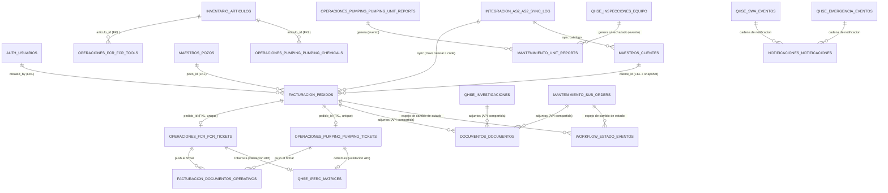
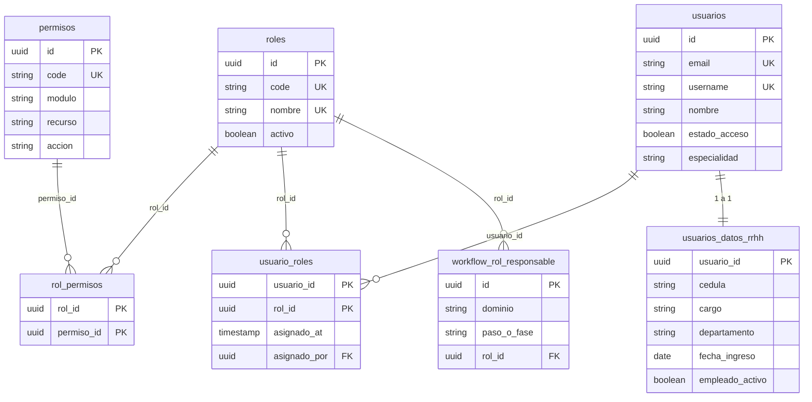
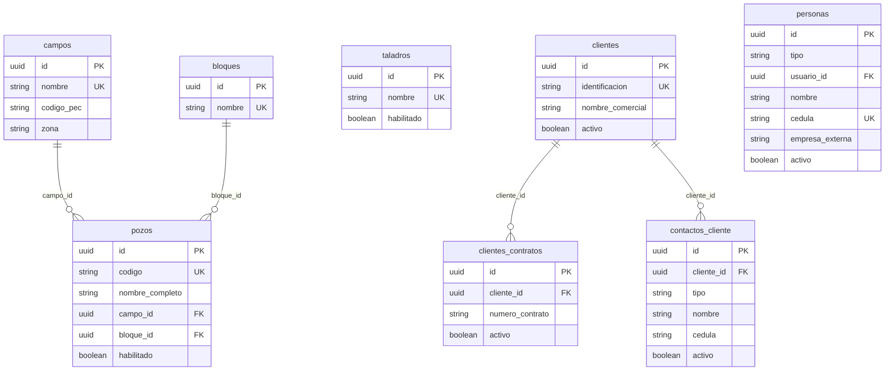
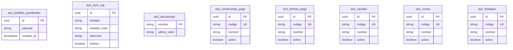
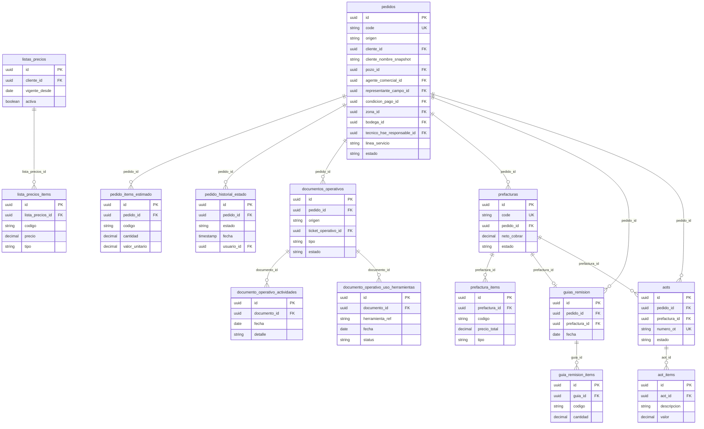
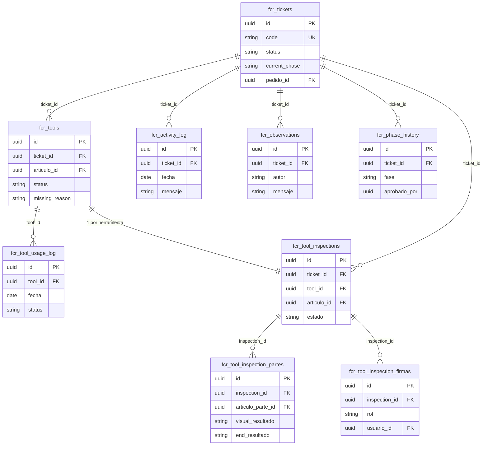
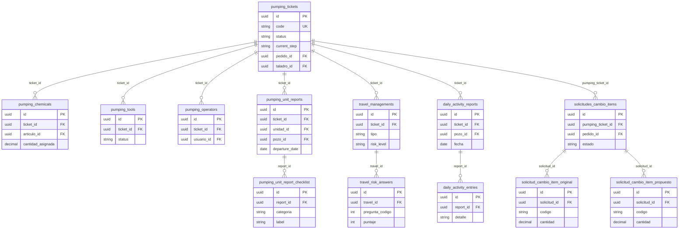
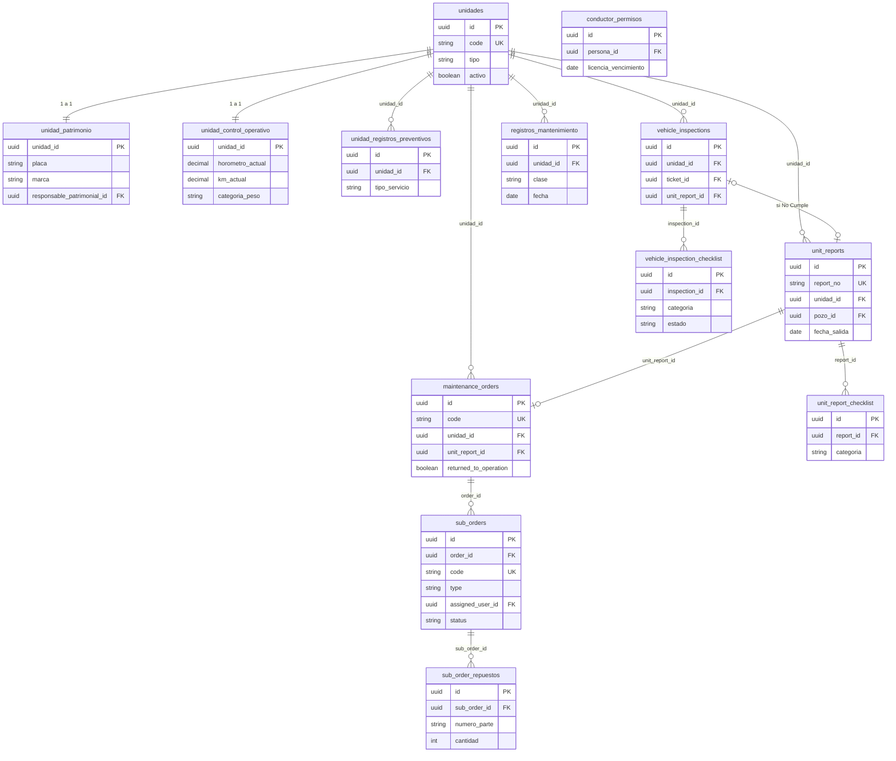
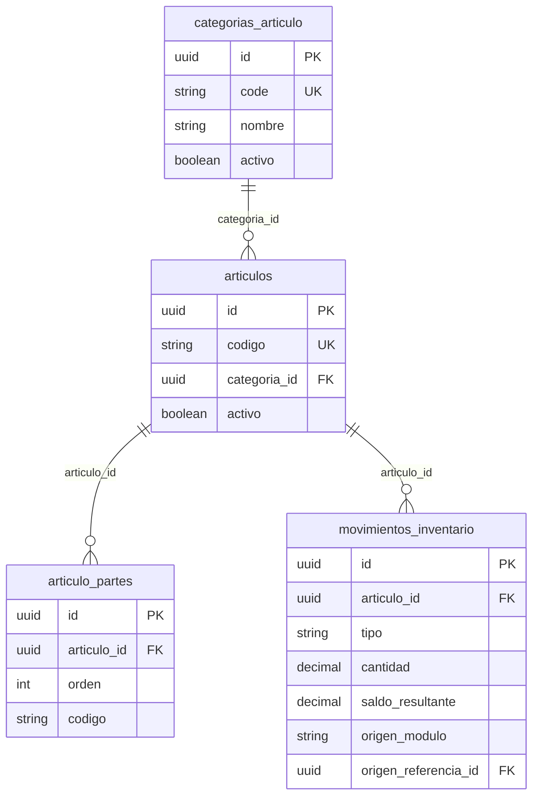

# Diagrama ER completo — Dynadrill (Mermaid)

> Generado a partir de [`schema-propuesto.prisma`](./schema-propuesto.prisma) (Etapa 2, ya aprobado y revisado — incluye la corrección de RBAC en `auth`, la generalización de `maestros.personas`, los catálogos AS2, el split de `Unidad` y las demás correcciones de la revisión crítica del 2026-09-18). Cada bloque es un diagrama Mermaid independiente. Se dividió **por schema** (en vez de un único diagrama de ~80 tablas) porque un solo diagrama de ese tamaño es ilegible; al final hay un diagrama de alto nivel con las relaciones **entre** schemas/microservicios. Si quieres todo en un solo diagrama, usa [`diagramas-mermaid/todo-en-uno.mmd`](./diagramas-mermaid/todo-en-uno.mmd).
>
> **⚠️ Si tu visor te da `UnknownDiagramError: No diagram type detected`:** es porque copiaste el `.md` completo (con los títulos, el índice y el texto en prosa) dentro de un renderer que solo acepta sintaxis Mermaid pura — no sabe qué hacer con el Markdown alrededor. Dos formas de arreglarlo:
> 1. Copia **solo** el contenido entre las líneas ` ```mermaid ` y ` ``` ` de cada bloque (sin esas líneas de cerca), o
> 2. Usa los archivos ya listos para pegar sin editar nada, en [`diagramas-mermaid/`](./diagramas-mermaid/) — cada uno (`00-alto-nivel.mmd`, `01-auth.mmd`, ... `10-transversales.mmd`, más `todo-en-uno.mmd`) contiene *solo* el diagrama, sin Markdown alrededor.
>
> Convención: `PK` = clave primaria (`UUID`), `FK` = referencia física real (mismo schema), `FKL` = referencia lógica (cruza schema, sin constraint física — ver §3.3/§7 del análisis).

## Índice
1. [Alto nivel — relaciones entre microservicios](#1-alto-nivel--relaciones-entre-microservicios)
2. [`auth`](#2-schema-auth)
3. [`maestros`](#3-schema-maestros)
4. [`integracion_as2`](#4-schema-integracion_as2)
5. [`facturacion`](#5-schema-facturacion)
6. [`operaciones_fcr`](#6-schema-operaciones_fcr)
7. [`operaciones_pumping`](#7-schema-operaciones_pumping)
8. [`mantenimiento`](#8-schema-mantenimiento)
9. [`inventario`](#9-schema-inventario)
10. [`qhse`](#10-schema-qhse)
11. [`documentos` / `notificaciones` / `workflow`](#11-servicios-transversales)

---

## 1. Alto nivel — relaciones entre microservicios



---

## 2. Schema `auth`

> ✅ RBAC revisado: `usuarios` ya no tiene `rol_id` propio — el/los rol(es) se resuelven vía `usuario_roles`, y qué puede hacer cada rol vía `permisos`/`rol_permisos`.



---

## 3. Schema `maestros`

> ✅ `personas_contacto` se dividió: `contactos_cliente` (solo representantes del cliente) + `personas` (nuevo, catálogo compartido interno/externo reusado por Mantenimiento y QHSE).



---

## 4. Schema `integracion_as2`

> ✅ Se agregaron los catálogos que AS2 realmente posee (condición de pago, forma de pago, canal, zona, bodega) — antes texto libre en `Pedido`.



---

## 5. Schema `facturacion`



---

## 6. Schema `operaciones_fcr`



---

## 7. Schema `operaciones_pumping`



---

## 8. Schema `mantenimiento`

> ✅ `unidades` se dividió en identidad + `unidad_patrimonio` (Administración) + `unidad_control_operativo` (Mantenimiento). `conductor_permisos` ya no depende de una tabla `conductores` propia — referencia `maestros.personas`.



---

## 9. Schema `inventario`

> ✅ `categorias_articulo` (nuevo): `Articulo.categoria` deja de ser texto libre.



---

## 10. Schema `qhse`

> ✅ `rol_notificado` (texto libre) → `rol_notificado_id` (ref. a `auth.roles`) en `swa_notificaciones`/`emergencia_notificaciones`. Nueva tabla `investigacion_trabajador_involucrado`. `emergencia_heridos`/`entregas_epi` referencian `maestros.personas`.

```mermaid
erDiagram
    iperc_matrices {
        uuid id PK
        string code UK
        string estado
        uuid origen_ticket_id FK
    }
    iperc_tasks {
        uuid id PK
        uuid matrix_id FK
        int orden
    }
    iperc_hazards {
        uuid id PK
        uuid task_id FK
        int riesgo_inicial_nd
        int riesgo_inicial_ne
        int riesgo_inicial_nc
    }
    iperc_controles {
        uuid id PK
        uuid hazard_id FK
        string tipo
    }
    ptw_matrices {
        uuid id PK
        string code UK
        uuid iperc_matrix_id FK
        string fase
        boolean ptw_cerrado
    }
    ptw_gas_readings {
        uuid id PK
        uuid ptw_id FK
        decimal h2s
        decimal lel
    }
    ptw_daily_logs {
        uuid id PK
        uuid ptw_id FK
        date fecha
    }
    stop_cards {
        uuid id PK
        string code UK
        uuid observador_id FK
    }
    stop_card_items {
        uuid id PK
        uuid card_id FK
        string bloque
        string estado
    }
    swa_eventos {
        uuid id PK
        string estado
        uuid ticket_id FK
        uuid emergencia_id FK
    }
    swa_notificaciones {
        uuid id PK
        uuid swa_id FK
        uuid rol_notificado_id FK
    }
    derrame_eventos {
        uuid id PK
        string estado
        string volumen
        uuid desecho_generado_id FK
    }
    desechos {
        uuid id PK
        boolean peligroso
        string estado
    }
    desecho_manifiestos {
        uuid id PK
        uuid desecho_id FK
        string gestor_licencia_suia
    }
    desecho_certificados {
        uuid id PK
        uuid manifiesto_id FK
        timestamp recibido_at
    }
    emergencia_eventos {
        uuid id PK
        int nivel
        string estado
        uuid origen_derrame_id FK
    }
    emergencia_timeline {
        uuid id PK
        uuid emergencia_id FK
        timestamp hora
    }
    emergencia_heridos {
        uuid id PK
        uuid emergencia_id FK
        uuid persona_id FK
        string triage_color
        int dias_perdidos
    }
    emergencia_signos_vitales {
        uuid id PK
        uuid herido_id FK
        timestamp hora
    }
    emergencia_notificaciones {
        uuid id PK
        uuid emergencia_id FK
        uuid rol_notificado_id FK
    }
    entregas_epi {
        uuid id PK
        string code UK
        uuid trabajador_id FK
    }
    epi_items {
        uuid id PK
        uuid entrega_id FK
        string elemento
    }
    inspecciones_equipo {
        uuid id PK
        string code UK
        string tipo
        string resultado
    }
    investigaciones {
        uuid id PK
        string resultado
        string estado
        uuid origen_emergencia_id FK
    }
    investigacion_trabajador_involucrado {
        uuid investigacion_id PK
        uuid persona_id FK
        int dias_perdidos
    }
    investigacion_testigos {
        uuid id PK
        uuid investigacion_id FK
    }
    investigacion_cinco_porques {
        uuid id PK
        uuid investigacion_id FK
        int orden
    }
    investigacion_acciones_correctivas {
        uuid id PK
        uuid investigacion_id FK
        string tipo
        string estado
    }
    investigacion_notificacion_legal {
        uuid id PK
        uuid investigacion_id FK
    }
    dashboard_metas {
        int id PK
        json payload_metas
    }
    horas_hombre_periodo {
        uuid id PK
        date fecha
        uuid pozo_id FK
        string contratista
    }
    capacitaciones {
        uuid id PK
        string tema
        date fecha
    }
    capacitacion_asistentes {
        uuid id PK
        uuid capacitacion_id FK
        uuid usuario_id FK
        boolean aprobado
    }

    iperc_matrices ||--o{ iperc_tasks : matrix_id
    iperc_tasks ||--o{ iperc_hazards : task_id
    iperc_hazards ||--o{ iperc_controles : hazard_id
    iperc_matrices ||--o{ ptw_matrices : habilita
    ptw_matrices ||--o{ ptw_gas_readings : ptw_id
    ptw_matrices ||--o{ ptw_daily_logs : ptw_id
    stop_cards ||--o{ stop_card_items : card_id
    swa_eventos ||--o{ swa_notificaciones : swa_id
    swa_eventos ||--o| emergencia_eventos : escala
    derrame_eventos ||--o| desechos : genera
    derrame_eventos ||--o| emergencia_eventos : escala
    emergencia_eventos ||--o{ emergencia_timeline : emergencia_id
    emergencia_eventos ||--o{ emergencia_heridos : emergencia_id
    emergencia_heridos ||--o{ emergencia_signos_vitales : herido_id
    emergencia_eventos ||--o{ emergencia_notificaciones : emergencia_id
    emergencia_eventos ||--o| investigaciones : obliga
    investigaciones ||--o| investigacion_trabajador_involucrado : investigacion_id
    entregas_epi ||--o{ epi_items : entrega_id
    desecho_manifiestos ||--o| desecho_certificados : manifiesto_id
    investigaciones ||--o{ investigacion_testigos : investigacion_id
    investigaciones ||--o{ investigacion_cinco_porques : investigacion_id
    investigaciones ||--o{ investigacion_acciones_correctivas : investigacion_id
    investigaciones ||--o| investigacion_notificacion_legal : investigacion_id
    capacitaciones ||--o{ capacitacion_asistentes : capacitacion_id
```



---

## 11. Servicios transversales

```mermaid
erDiagram
    documentos {
        uuid id PK
        string entidad_tipo "ref. lógica a cualquier schema"
        uuid entidad_id FKL
        string categoria
        string ruta_relativa "directorio dedicado del servidor, §17.15"
        int version
        uuid documento_anterior_id FK
    }
    notificaciones {
        uuid id PK
        string entidad_tipo
        uuid entidad_id FKL
        string tipo
        string canal
        uuid destinatario_id FKL
        uuid destinatario_rol_id FKL
        string estado
    }
    estado_eventos {
        uuid id PK
        string entidad_tipo
        uuid entidad_id FKL
        string dominio
        string estado_anterior
        string estado_nuevo
        uuid usuario_id FKL
    }

    documentos ||--o{ documentos : "version_anterior (self)"
```
